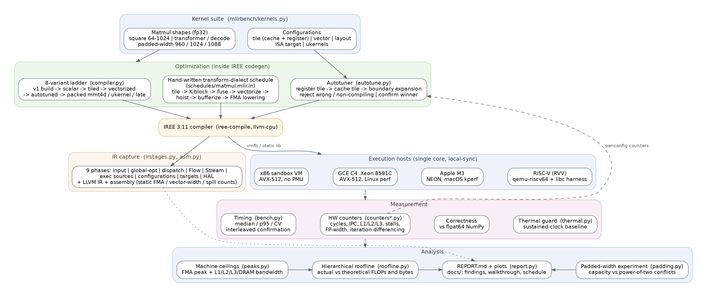

# MLIRBench: a compiler optimization study of matmul in MLIR / IREE

**Rudra Brahmbhatt** · MS Computer Science, Texas State University · [github.com/Rudra2122](https://github.com/Rudra2122)

I take one operation, an fp32 `linalg.matmul`, and follow it all the way through a real ML compiler: from MLIR, through IREE's nine compilation phases, down to the AVX-512, NEON and RISC-V vector instructions it becomes. Along the way I measure what each optimization is actually worth, and use hardware counters to explain why.

The project runs on three machines: an Intel Emerald Rapids server on Google Cloud, an Apple M3 laptop, and a development VM. It covers two instruction sets, plus RISC-V under emulation. Every number below comes from a JSON file in `results*/` produced by the code in this repo.

MLIRBench v1 was a single 128³ measurement with one roofline point. This version exists because v1's main conclusion turned out to be wrong, and finding out *why* it was wrong turned into the rest of the project.

<p align="center">
  
</p>

---

## What I found

- **v1's "memory-bound" diagnosis was wrong.** The v1 build never told the compiler which CPU to target, so on x86 it produced scalar code. Hardware counters show it missing L1 on only 0.23% of loads and retiring 100% scalar FP instructions: 1.42 of a possible 64 FLOP/cycle. Targeting the real CPU makes the same kernel **34× faster** at 128³.
- **The autotuner beats IREE's own tile choices by 1.27–3.55× on Intel,** and the reason is register pressure. IREE's x86 default keeps 8 of the 32 AVX-512 registers as accumulators; every square-shape winner uses 16 or more. On the M3, IREE's ARM default already uses 16, and tuning gains only 1.04–1.10×. The same explanation holds on both architectures.
- **I wrote my own codegen schedule in MLIR's transform dialect.** It replaces IREE's pipeline for the matmul and matches it at 128³ and 512³ (99.5–99.8% on Intel, 99.8–102.4% on the M3). It also adds K blocking, which IREE's configuration can't express, and that is 1.31× faster than IREE with the same tiles at 1024³.
- **The 1024³ slowdown is a cache-set conflict, not a capacity problem.** 1088³ is a bigger problem than 1024³, yet runs **2× faster**. B's rows are exactly 4096 bytes, so walking down a column crowds its lines into a few L2 sets: L2 misses per FLOP spike 6.2× at exactly 1024. Changing only B's row width removes the spike.
- **Hardware counters confirm the analytic model where it should hold, and show where it breaks.** Measured FLOPs equal 2·M·N·K exactly in all 24 profiled configurations. Measured L2 traffic ranges from 1.04× the theoretical minimum (autotuned, 512³) to 44× (IREE's default, 1024³). I decomposed the 44× into about 6–7× capacity and about 6× set conflicts.
- **Packing wins only when there's enough reuse.** At 1024³ it cuts L2 stall cycles from 22% to 4% without reducing traffic. At 128³ and for single-token decode its copies cost more than they save: 11× slower for the GEMV.
- **The binary IREE ships matches its assembly, and checking it corrected one of my numbers.** I read the linked ELF with `readelf`, `nm`, `objdump` and `llvm-dwarfdump` on x86-64, AArch64 and RISC-V. For all 22 dispatch functions, objdump's FMA, vector and spill counts equal what I got from the `.s`, and the symbol-table size equals the DWARF address range. It also showed that the "baseline of 22" stack accesses I had quoted came from runtime helpers (`expf`, `powf`) that the linker drops: the spilling tiles have **154–382** stack accesses in the dispatch itself, against 0.
- **The best kernels run close to the hardware limit:** 59.1 of 64 FLOP/cycle (92%) on Intel at 512³, and 94% of the measured peak on the M3 at 1024³.

---

## What I corrected from v1

| v1 said | What I found | Evidence |
|---|---|---|
| "The 128³ matmul is memory-bound" | It was built for a generic CPU and ran scalar code. It barely touches memory: 0.23% L1 miss rate at 128³, zero L2-miss stall cycles at 512³ and 1024³. | `results_c4/counters.json`, `docs/COUNTER_FINDINGS.md` |
| One roofline point, measured against DRAM bandwidth | A 128³ matmul fits in L2, so DRAM is the wrong roof. v2 measures one roof per cache level and picks the level the data actually lives in. | `mlirbench/peaks.py`, `mlirbench/roofline.py` |
| Peak compute = a NumPy matmul | NumPy's matmul is itself a kernel, not a ceiling. v2 measures FMA peak with a dedicated C microbenchmark. | `microbench/peak_fma.c` |
| Timing through a Python loop | That included interpreter overhead in every sample. v2 times with `iree-benchmark-module` and reports median, p95 and CV. | `mlirbench/bench.py` |
| "Evaluated on RISC-V" | v1 only cross-compiled. v2 executes the kernel under QEMU and checks the result, and claims correctness only. | `mlirbench/riscv.py` |

The original v1 files are kept in `legacy/`.

---

## Tech stack

| Area | Technologies |
|---|---|
| Compiler | MLIR (`linalg`, `tensor`, `vector`, `scf`, `memref`, `transform` dialects), IREE 3.11 (`iree-compile`, llvm-cpu backend, data tiling, mmt4d microkernels), LLVM |
| Hand-written codegen | MLIR transform dialect: `tile_using_forall`, `tile_using_for`, `structured.fuse`, `vectorize_children_and_apply_patterns`, `hoist_loop_invariant_subsets`, `iree.bufferize`, vector lowering patterns |
| Runtime and benchmarking | IREE runtime (Python bindings), `iree-benchmark-module` (Google Benchmark) |
| Languages | Python 3.12, C (microbenchmarks, a libc-only IREE dispatch harness), MLIR |
| Hardware counters | Linux `perf` (23 events incl. `l2_rqsts`, `cycle_activity`, `fp_arith_inst_retired`, `mem_load_retired`); macOS kperf via ctypes (private framework, per-thread PMU); Instruments `xctrace` backend (written, untested) |
| RISC-V | `riscv64-linux-gnu-gcc`, `qemu-riscv64` user mode, RVV 1.0 |
| ELF and DWARF | GNU Binutils (`readelf`, `nm`, `objdump`, `aarch64-` / `riscv64-linux-gnu-objdump`), `llvm-objdump`, `llvm-dwarfdump` (`.debug_info`, `.debug_line`) |
| Analysis | NumPy, matplotlib, Graphviz |
| Hardware | Google Cloud `c4-standard-8` (Intel Xeon Platinum 8581C, Emerald Rapids, PMU enabled); Apple MacBook Air M3; an x86 AVX-512 development VM |
| Tooling | GNU Make, tmux, Google Cloud Shell |

---

## Architecture

The diagram above shows the flow. In words:

1. **Kernel suite** (`kernels.py`) generates a `linalg.matmul` in MLIR for any shape, optionally with an explicit tile configuration attached as `#iree_codegen.compilation_info`.
2. **Optimization happens inside IREE's code generator**, in one of three ways:
   - by choosing its knobs: target ISA, data tiling, microkernels (the 8-variant ladder);
   - by searching its tile sizes (the autotuner);
   - by replacing its pipeline with my own transform-dialect schedule.
3. **IREE compiles** each kernel to an executable, and `irstages.py` captures the IR at all nine phases, plus LLVM IR and assembly.
4. **Each kernel runs** single-threaded on one of the hosts. It is checked against a float64 NumPy result, timed, and optionally profiled with hardware counters.
5. **Analysis** compares measured FLOPs and bytes with the hierarchical roofline, then writes `REPORT.md` and plots for each host.

| Component | File | What it does |
|---|---|---|
| Kernel generation | `mlirbench/kernels.py` | Shapes, tile configs, MLIR text |
| Optimization ladder | `mlirbench/compiler.py` | 8 compiler configurations, one change per rung |
| Autotuner | `mlirbench/autotune.py` | Staged tile search, correctness rejection, boundary expansion, per-config counters |
| Hand-written schedule | `schedules/matmul.mlir.in`, `mlirbench/schedule.py` | Transform-dialect codegen, stage-switchable, compared against IREE |
| Timing and correctness | `mlirbench/bench.py`, `mlirbench/inproc.py` | Median / p95 / CV; float64 NumPy reference |
| Hardware counters | `mlirbench/counters.py`, `counters_kperf.py`, `counters_xctrace.py` | perf / kperf / xctrace, iteration differencing, sanity checks |
| Machine ceilings | `mlirbench/peaks.py`, `microbench/*.c` | FMA peak, per-cache-level read bandwidth |
| Roofline | `mlirbench/roofline.py` | Picks the roof for the level the working set lives in |
| IR capture | `mlirbench/irstages.py`, `mlirbench/asm.py` | 9 IREE phases; static FMA / vector-width / spill counts |
| Padded-width experiment | `mlirbench/padding.py` | Capacity vs power-of-two set conflicts |
| Thermal guard | `mlirbench/thermal.py` | Detects clock throttling between chunks of work |
| RISC-V | `mlirbench/riscv.py`, `harness/` | RVV cross-compile, QEMU execution |
| ELF / DWARF | `mlirbench/elfinspect.py` | ELF headers, sections and symbol tables; objdump vs `asm.py` cross-check; hot loop → MLIR line via `.debug_line` |
| Report | `mlirbench/report.py` | `REPORT.md` and plots from the JSON |

---

## Hardware

| | Google Cloud C4 (primary) | Apple M3 | Development VM |
|---|---|---|---|
| CPU | Intel Xeon Platinum 8581C (Emerald Rapids) | Apple M3, performance core | Intel Xeon (Emerald Rapids family) |
| Vectors | AVX-512 (16 fp32 lanes) | NEON (4 fp32 lanes) | AVX-512 |
| L2 | 2 MiB per core | 16 MiB, shared performance cluster | 2 MiB per core |
| Measured FP32 peak, 1 core | 240.2 GFLOP/s | 120.8 GFLOP/s | 171.1 GFLOP/s |
| Measured read bandwidth L1 / L2 / L3 / DRAM | 446 / 189 / 38 / 20 GB/s | 174 / 108 / – / 65 GB/s | 328 / 135 / 29 / 18 GB/s |
| Hardware counters | Linux perf, 23 events | macOS kperf, 10 events | none (no PMU exposed) |
| Results | `results_c4/` | `results_m3/` | `results/` |

All measurements are single-threaded on IREE's synchronous `local-sync` device, so each roofline is a per-core roofline.

---

## How I worked: the optimization loop

Every experiment below follows the same six steps: **Observation → Hypothesis → Evidence → Change → Result → Tradeoff.** When the evidence contradicted the hypothesis, I kept the hypothesis in the write-up and said so.

### 1. The v1 build was compiled for the wrong CPU

- **Observation:** v1 measured 128³ at a small fraction of peak and concluded it was memory-bound.
- **Hypothesis:** a 128³ fp32 matmul touches 192 KiB and fits in L2, so it shouldn't be memory-bound at all.
- **Evidence:** v1's own Flow IR contains `cpu = ""` and `native_vector_size = 16`, the signature of a generic x86-64 target. Rebuilt the same way, IREE 3.11 lowers the inner tile to a portable scalar microkernel: zero packed FMAs in the assembly. On C4, counters show a 0.23% L1 miss rate, 100% scalar FP instructions and 1.42 of 64 FLOP/cycle at 128³, and zero L2-miss stall cycles at 512³ and 1024³.
- **Change:** pass `--iree-llvmcpu-target-cpu=host`.
- **Result:** 128³ goes from 0.754 ms to 0.0286 ms with IREE's default tiles (26×), and to 0.0219 ms autotuned (**34×**).
- **Tradeoff:** the binary is tied to the host ISA. On the M3 the same v1 flags are fine, because AArch64's baseline already includes NEON: 112.3 GFLOP/s at 1024³. The v1 problem was x86-specific.

### 2. The optimization ladder

One kernel, eight builds, one change per rung. C4 results, time (GFLOP/s):

| Variant | 128³ | 512³ | 1024³ | 128×768×3072 (FFN) | 1×4096×4096 (GEMV) |
|---|---|---|---|---|---|
| v1 build (generic ISA) | 0.754 ms (5.6) | 62.1 ms (4.3) | 531 ms (4.0) | 152.7 ms (4.0) | 31.0 ms (1.1) |
| scalar, untiled | 1.629 ms (2.6) | 133.2 ms (2.0) | 3452 ms (0.6) | 868 ms (0.7) | 84.3 ms (0.4) |
| scalar, tiled 64×64 | 1.653 ms (2.5) | 132.6 ms (2.0) | 3452 ms (0.6) | 865 ms (0.7) | 84.8 ms (0.4) |
| tiled + vectorized, IREE default tiles | 0.0286 ms (147) | 1.961 ms (137) | 41.5 ms (52) | 11.26 ms (54) | 7.94 ms (4.2) |
| tiled + vectorized, **autotuned** | **0.0219 ms (191)** | **1.279 ms (210)** | 18.9 ms (114) | 5.77 ms (105) | **2.26 ms (14.8)** |
| packed (mmt4d, codegen) | 0.0339 ms (124) | 1.840 ms (146) | **15.0 ms (143)** | **4.77 ms (127)** | 24.6 ms (1.4) |
| packed (mmt4d microkernel) | 0.0359 ms (117) | 1.834 ms (146) | 15.1 ms (143) | 4.80 ms (126) | 24.6 ms (1.4) |
| packed (late materialization) | 0.0484 ms (87) | 1.759 ms (153) | 15.1 ms (143) | 4.92 ms (123) | 25.1 ms (1.3) |

- **Scalar code:** cache tiling does nothing, identical in time and in counters. The 64×64 tile is on M and N, but the inner loop runs over K and walks down B one row (one cache line) at a time, and tiling doesn't change that stride.
- **Packing:** wins at 1024³ and on the FFN shape, loses at small sizes and badly on the GEMV (next sections).
- **The mmt4d microkernel:** matches compiler-generated code everywhere. On this target MLIR codegen already emits the same broadcast-from-memory FMA pattern.

### 3. The autotuner

- **Observation:** IREE's heuristic picks the same register tile (`8×16`) for every square shape on x86.
- **Hypothesis:** an 8×16 tile holds only 8 zmm accumulators. With a 4-cycle FMA latency and 2 FMA ports, that's the bare minimum to keep the FMA units busy, with no slack for loads.
- **Change:** search the space instead of assuming.
  - Register tiles: `vm` ∈ {1,2,4,8,16} × `vn` ∈ {1,2,4 vectors} × `vk` ∈ {1,2,4,8,16}, then cache tiles `tm, tn` ∈ {16…256}.
  - Each candidate is compiled, checked against NumPy (non-compiling and incorrect ones rejected), and benchmarked five times; the winner is re-measured against the default before any speedup is reported.
  - When the winner sits on the edge of the search space, the tuner keeps widening past it while that helps.
- **Result:**

| Shape | IREE default → autotuned | C4 speedup | Dev VM speedup | M3 speedup |
|---|---|---|---|---|
| 128³ | `d16x64_v8x16x16` → `d16x32_v8x32x4` | 1.27× | 1.29× | 1.04× |
| 512³ | `d64x64_v8x16x16` → `d16x256_v4x64x8` | 1.68× | 1.64× | 1.06× |
| 1024³ | `d64x64_v8x16x16` → `d256x256_v16x32x4` | 2.23× | 2.10× | 1.10× |
| 128×768×3072 | `d64x64_v8x16x16` → `d128x128_v8x64x2` | 1.97× | 1.88× | – |
| 32×4096×4096 | `d32x64_v8x16x16` → `d16x64_v16x64x1` | 2.25× | 2.11× | – |
| 1×4096×4096 | `d0x64_v1x16x16` → `d0x64_v1x64x8` | 3.55× | 3.54× | 1.93× |

(Tile key: `d<tm>x<tn>` is the cache tile, one per workgroup; `v<vm>x<vn>x<vk>` is the register tile, which becomes one `vector.contract`.)

- **Evidence for the hypothesis:**
  - At 128³ and 512³ every winner holds **16 accumulators**. Tiles needing 64 accumulators spill (on the development VM: 154–382 vector stack accesses in the dispatch function, against 0 for the winners; section 9 explains why I first reported 176–404) and run at about half the throughput.
  - On the M3, IREE's ARM default (8×8 on 4-lane NEON) *already* holds 16, which is why tuning barely helps there.
  - With per-config counters on C4 (about 90 configs per shape), what decides the ranking changes with size. At 512³, L2 behaviour is flat across all tiles (r = +0.09) and IPC decides (r = +0.75). At 1024³, the fraction of cycles stalled on L2 misses explains the ranking almost perfectly (r = −0.96).
- **Tradeoff:** the search is staged (register tile, then cache tile), so it can miss joint optima; `--strategy grid` is exhaustive but slow. Near-ties aren't resolved: the C4 512³ winner changed between two runs, 0.7% apart. The tuner finds a region, not a unique point.

### 4. Packing: what it changes in memory, and when it pays

- **Observation:** packing loses at 128³ but wins at 1024³.
- **What it does:** with data tiling, at the global-optimization phase IREE rewrites the matmul into `linalg.pack` (A), `linalg.pack` (B), `linalg.mmt4d` and `linalg.unpack`.
  - A is copied into 16-row panels whose 16 values for each K step sit side by side; B is copied into column panels the same way.
  - The inner kernel then reads both operands with unit stride, broadcasting A straight from memory into the FMA (`vfmadd231ps mem{1to16}`).
  - The copies are real allocations: 192 KiB of transient buffers at 128³.
- **Evidence (C4 counters):**
  - At 512³, packing fills L2 with 3.2× the compulsory bytes, against 1.04× for tuned direct code, and loses (1.76 vs 1.28 ms).
  - At 1024³ it moves about the same traffic as tuned code (25× vs 23×) but stalls on L2 misses in 4% of cycles instead of 22%, holding about 40 FLOP/cycle from 512³ to 1024³ while every unpacked variant degrades.
  - On the GEMV, packing moves 3.35× the compulsory bytes (read B, write the copy, read it again) for no reuse at all.
- **Result:** the crossover in section 2. The M3 shows the same pattern one cache level closer: unpacked tiles refill L1 5–10× more than packed ones at 1024³, so packing wins there too.
- **Tradeoff:** packing needs reuse to pay back its copies. It's the right default for large prefill-style shapes and the wrong one for decode.

### 5. My own codegen: a transform-dialect schedule

- **Observation:** everything above tunes *IREE's* codegen. I wanted to write the transformations myself.
- **Change:** `schedules/matmul.mlir.in` replaces IREE's pipeline for the matmul dispatch. The matmul carries `translation_info<pipeline = TransformDialectCodegen>`, and my script receives the dispatch on tensors and must hand back a finished function. Each stage can be switched on or off:

| Stage | Transformation | C4 128³ | C4 512³ | C4 1024³ |
|---|---|---|---|---|
| S1 | tile to workgroups + registers, vectorize (IREE's default `vector.contract` lowering) | 0.555 ms | 36.8 ms | 281.5 ms |
| S2 | + lower `vector.contract` → outer products → FMAs | 0.0291 | 1.527 | 39.2 |
| S3 | + hoist the C accumulator out of the K loop (on tensors) | 0.0219 | 1.234 | 22.0 |
| S4 | + fuse the zero-fill into the register tile | **0.0212** | **1.208** | 20.5 |
| S5 | + K blocking (TK searched) | 0.0221 | 1.248 | **14.2** |
| – | IREE's pipeline, same tiles | 0.0211 | 1.203 | 18.6 |
| – | IREE packed (its best at 1024³) | 0.0464 | 1.691 | 14.3 |

- **What each stage taught:**
  - **S1 → S2 (4–31× across hosts):** left to the final LLVM conversion, `vector.contract` produced zero AVX-512 FMA instructions.
  - **S2 → S3 (1.2–3.2× across hosts):** hoisting after bufferization silently did nothing; hoisting on tensors worked.
  - **Engineering note:** applying all the vector-lowering patterns together made them rewrite each other in a loop and hang the compiler. They only work as separate, ordered stages.
- **Result:**
  - S4 is at parity with IREE's own pipeline at 128³ and 512³, on all three hosts.
  - K blocking, which IREE 3.11's lowering config can't express (every `cache_reduction` value fails to compile), is 1.31× faster than IREE with the same tiles at 1024³ and **ties** IREE's best configuration (14.18 vs 14.29 ms).
  - The same file runs unchanged on the M3, emitting NEON `fmla` at 99.8–104% of IREE.
- **Tradeoff:** it handles only static shapes with full tiles (IREE also does masking, peeling, dynamic shapes and fusion). Without K blocking it's 7–10% behind IREE at 1024³, a stable gap I haven't diagnosed.

### 6. Why 1024³ is slow: capacity or cache-set conflicts?

- **Observation:** at 1024³ IREE's default tiles hit a 75% L2 miss rate (6% at 512³) and fill L2 with **44×** the compulsory bytes. A capacity model (B no longer fits in L2 and is re-streamed once per row of workgroups) predicts only about 6×.
- **First hypothesis:** capacity: the working set overflows L2, and K blocking helps by shrinking it.
- **Evidence against it:** C4's autotuned tiles are 64×64, whose per-workgroup working set (about 528 KiB) already fits in the 2 MiB L2, yet K blocking still helped there. My capacity explanation couldn't be the whole story.
- **Second hypothesis:** B's rows are exactly 4096 bytes, a power of two, so walking down a column of B lands on the same few cache sets.
- **Change (the experiment):** bracket 1024³ with 960³ and 1088³ (non-power-of-two rows), and vary one operand's row width at a time. Tiles are fixed across all shapes so IREE's heuristics can't confound the comparison.

| C4, IREE fixed tiles | 960³ | **1024³** | 1088³ | only B's row width → 1088 | only A's row width → 1088 |
|---|---|---|---|---|---|
| GFLOP/s | 100.2 | **49.7** | 99.4 | 98.1 | 49.3 |
| L2 misses per kFLOP | 0.65 | **4.04** | 0.63 | 0.64 | 4.07 |
| cycles stalled on L2 misses | 13% | **57%** | 13% | 12% | 57% |
| bytes into L2 ÷ compulsory | 6.6× | **44.1×** | 7.4× | 7.2× | 45.3× |

- **Result:**
  1. **It's set conflicts, not capacity.** 1088³ is the larger problem and runs twice as fast. L2 misses spike 6.2× at exactly 1024. The neighbours fill L2 with 6.6–7.4× the minimum, which matches the capacity model, so 1024³'s 44× is about 6–7× capacity plus about 6× conflicts.
  2. **B is the culprit.** Changing only B's row width removes the spike completely; changing A's does nothing.
  3. **In my own schedule, A causes a second conflict, in L1.** Its register tile reads 16 rows of A at each K step, 4096 bytes apart, and all 16 land in one 12-way L1 set; IREE's 8-row tile fits. The operand-isolation rows separate the two conflicts cleanly. The mechanism is inferred.
  4. **K blocking makes the conflict misses cheaper, not rarer.** At TK = 64 it slightly *increases* L2 misses (2.10 → 2.38 per kFLOP) but cuts L2-stall cycles from 34% to 9%: 1.32× faster at 1024³, and nothing at 960³ or 1088³.
- **Tradeoff:** the fix is shape-specific. On the M3, whose 16 MiB L2 holds the whole problem, K blocking does nothing.

### 7. Decode shapes and the GEMV

- **Observation:** single-token decode (1×4096×4096) is the most memory-bound shape: 0.5 FLOP per byte.
- **Evidence (C4):**
  - IREE's default and the tuned tile move *identical* traffic, 1.02× the minimum (every weight byte read once), yet the tuned tile is 3.5× faster: 8.5 → 29.7 GB/s, 77% of the measured L3 bandwidth.
  - Its wider loads (`v1x64`, 4 zmm per step) stall less, consistent with more memory accesses in flight; that part is an inference.
  - No load reached DRAM for any profiled shape on this host (zero L3 misses), because the 64 MB of weights fit its large L3.
- **Result:** 3.55× from tuning on Intel. On the M3 tuning gave 1.93× (4.86 ms), but that's still only about 21% of DRAM bandwidth, the weakest result in the project.
- **Tradeoff:** the GEMV winner sat on the edge of the search space on both ISAs. On Intel one step wider was slower, confirming the optimum. On the M3 it hasn't been checked.

### 8. RISC-V: what it proves and what it doesn't

- IREE compiles the dispatch for `riscv64` with the vector extension as a static library.
- A small C harness that needs only libc (`harness/static_dispatch_harness.c`) walks IREE's workgroup grid through its executable ABI.
- It runs under `qemu-riscv64`.
- **Proves:**
  - The vectorized build passes at vector lengths 128, 256 and 512 (max relative error ≤ 4.3×10⁻⁷), including a non-power-of-two 64×96×80 shape.
  - With the vector extension disabled it crashes on an illegal instruction, which proves RVV code executes.
  - Statically, the vector build's dispatch has 9 RVV FMA instructions where the scalar build's has 256 `fmadd.s` (269 across the whole `.s`, which also holds runtime helpers; see section 9).
- **Doesn't prove:** anything about RISC-V performance, caches or timing (QEMU is functional emulation), and the harness bypasses IREE's runtime.

### 9. Reading the shipped binary: ELF, symbol tables, objdump and DWARF

- **Observation:** every static count so far (FMAs, vector width, spills) came from the `.s` IREE prints. That is what the compiler meant to emit, not the file that runs.
- **Hypothesis:** the linked ELF should contain the same instructions, so counts from objdump should equal counts from the `.s`.
- **Change:** `mlirbench/elfinspect.py` compiles with `--iree-llvmcpu-debug-symbols=true` and reads IREE's dumped `.o` and linked `.so` with standard tools:
  - `readelf -h -S`: ELF64, `REL` / `DYN` / `EXEC`, machine `X86-64` / `AArch64` / `RISC-V`, and the section table.
  - `readelf -s` and `nm -S`: the symbol tables, read by two tools.
  - `objdump -d --disassemble=<dispatch>` (GNU cross objdumps for AArch64 and RISC-V): classified with the same rules as `asm.py`.
  - `llvm-dwarfdump --debug-info / --debug-line`: the dispatch's address range from `DW_TAG_subprogram`, and the hottest loop mapped back to lines of the MLIR it was compiled from.
- **Result:**

| Check | Result |
|---|---|
| FMA / vector / load / store / spill counts, `.s` vs objdump | equal for **22/22** dispatch functions (x86-64, AArch64, RISC-V; 128³ and 512³) |
| `.o` symbol size = `nm` size = DWARF `high_pc − low_pc` in the linked `.so` | **22/22** (e.g. 1,755 bytes for the 128³ x86 matmul) |
| Symbols the linked `.so` keeps | only `iree_hal_executable_library_query`; dispatches are reached through the function table it returns, so only DWARF still names them |
| Linker garbage collection | 33–36 `FUNC` symbols and 4.2–5.8 KB of `.text*` in the `.o` become 608–2,033 bytes of `.text` |
| Hot loop → `.debug_line` | packed variants: 100% of the loop maps to `linalg.pack` / `linalg.mmt4d` / `linalg.unpack`. Matmul: only 10–39% maps to `linalg.matmul`; the FMAs keep just the function's location |

- **What it corrected:** the unused runtime helpers are in the `.s` too, and `asm.py` counted every function in the file. On x86 they hold exactly 22 vector stack accesses and 13 scalar FMAs. So the spilling tiles have 154–382 stack accesses in the dispatch (objdump agrees), not "176–404 against a baseline of 22", and the scalar RISC-V dispatch has 256 `fmadd.s`, not 269. `asm.py` now reports a `dispatch_only` block next to the whole-file counts.
- **Tradeoff:** this is static: what the binary contains, not what the CPU retires (that's `counters.py`). Raw instruction totals differ by a few (alignment NOPs on x86; some scalar address arithmetic on AArch64/RISC-V that I haven't explained yet), so they're reported, not gated. Details and the ELF/DWARF background are in [docs/ELF_AND_DWARF.md](docs/ELF_AND_DWARF.md).

---

## Measurement methodology

- **Timing:** `iree-benchmark-module`, single thread, pinned core on Linux. Each row records median, p95, min and coefficient of variation. A fixed 1×1×1 kernel measures per-call overhead (1.7 µs on C4).
- **Confirming close results:** the autotuner re-benchmarks winner and default in a separate 11-repetition run. The schedule ladder re-measures its closest contenders in three interleaved rounds and uses the minimum, because on a shared host noise only adds time; one single 512³ sample in this project was 23% off.
- **Correctness:** every configuration is compared with a float64 NumPy matmul. Incorrect or non-compiling configurations are rejected, never ranked.
- **Hardware counters:** per-call counts come from iteration differencing, `(C[n₂] − C[n₁]) / (n₂ − n₁)`, which cancels start-up and loading. Events are collected in small groups so they're never multiplexed.
  - On macOS, kperf reads *the calling thread's* counters around in-process calls. That's valid because IREE's synchronous device runs the kernel on that thread; I verified per-call thread CPU time against benchmark latency.
  - Readings that are physically impossible (negative, or more than 64 events per cycle) are rejected and the pass is retried. That happened once, on the M3.
  - Validation on C4: counter-derived per-call CPU time matches the benchmark (18.56 vs 18.89 ms).
- **Thermal guard:** a 0.5 s FMA probe runs before and after every chunk of work and every 10 autotune configs. It flags chunks where the clock dropped below a baseline calibrated on the *sustained* clock. The first version calibrated on the cold burst clock and flagged the M3's normal burst-to-sustained step as throttling; the fixed version was validated on the M3.

---

## What went wrong along the way

These are in the repo on purpose; each one changed a conclusion or a method.

- **Two of my own hypotheses were wrong.**
  - I first explained K blocking's win as shrinking an over-large working set. That fits the development VM's 256×256 tiles, but not C4's 64×64 tiles, which already fit in L2. The padded-width experiment found the real cause.
  - I expected the autotuned tile to hide L2 misses by overlapping them. The counters showed it simply has 6.3× fewer loads that miss L2.
- **A claim didn't reproduce.** On the development VM, K blocking beat IREE's best configuration by 1.16×. On C4 it's a tie. The README reports the tie.
- **A development-VM anomaly didn't reproduce either:** tiled scalar code 20% slower than untiled at 1024³. On C4 they are identical in time and counters; it was VM noise.
- **Five measurement bugs, each found on real hardware:**
  - Apple's clang optimized away the bandwidth benchmark's repetitions, reporting 15,818 GB/s for L1.
  - ARM's destructive `fmla` made my FMA benchmark copy a register before every FMA, halving the M3's measured peak (54.5 → 120.8 GFLOP/s after the fix).
  - IREE writes ARM tile configs in a different field order, which broke my parser.
  - macOS keeps system frameworks in a shared cache rather than as files, which broke kperf detection.
  - Apple's PMU refused L1-miss events once the SIMD events had taken their counters; collection is now multi-pass.

---

## Repository structure

```
mlirbench/            Python package: kernels, compiler variants, autotuner, transform schedule driver,
                      benchmarking, counters (perf / kperf / xctrace), roofline, IR capture, asm analysis,
                      padded-width experiment, thermal guard, RISC-V, ELF/DWARF inspection, report
schedules/            matmul.mlir.in: the hand-written transform-dialect codegen schedule
microbench/           peak_fma.c, bandwidth.c: machine ceilings
harness/              libc-only IREE static-dispatch harness (used for RISC-V under QEMU)
docs/                 COUNTER_FINDINGS.md    every counter result, with the numbers
                      TRANSFORM_SCHEDULE.md  the hand-written schedule, stage by stage
                      COMPILER_WALKTHROUGH.md  Linalg -> Flow -> Stream -> HAL -> LLVM -> asm, with real IR
                      MACOS.md               running on Apple Silicon (kperf, throttling)
                      ELF_AND_DWARF.md       readelf / nm / objdump / llvm-dwarfdump checks, and what they found
tests/                parser tests for elfinspect.py (no IREE needed)
results_c4/           Google Cloud C4 (Intel, with counters): the primary results
results_m3/           Apple M3 (ARM, NEON)
results/              development VM (no counters)
figures/              architecture.dot / .png / .svg
legacy/               the original v1 files
```

Each `results*/` folder has a generated `REPORT.md` with every table and plot for that host.

---

## Reproduce

```bash
pip install -r requirements.txt            # IREE 3.11, NumPy, matplotlib
make all                                    # ceilings, autotune, ladder, sweep, schedule, IR, RISC-V, report

# hardware counters (Linux host with a PMU, e.g. GCE C4 with --performance-monitoring-unit=standard)
sudo sysctl kernel.perf_event_paranoid=1
python -m mlirbench counters
python -m mlirbench counters --schedule     # the hand-written schedule's kernels
python -m mlirbench tune --counters         # per-config counters in the autotuner
python -m mlirbench padding                 # capacity vs power-of-two conflicts
python -m mlirbench elf                     # ELF / symbol tables / objdump / DWARF (needs binutils or LLVM tools)
python tests/test_elfinspect.py             # parser tests
python scripts/spill_check.py               # reproduce the 176-404 -> 154-382 spill correction

# Apple Silicon: see docs/MACOS.md
make mac && make mac-counters
```

Point `MLIRBENCH_RESULTS` at a separate folder per machine; results merge per shape, so experiments can be run in pieces. `figures/architecture.png` is generated from `figures/architecture.dot` with `dot -Tpng -Gdpi=150`.

---

## Limitations

- **Scope:** single-threaded fp32 matmul only. No multi-threading, no bf16 or int8.
- **Unmeasured quantities:** absolute DRAM bytes (needs Google Cloud's higher PMU tier) and 4K-aliasing stalls (the event wasn't available on the VM). Apple exposes no L2 or DRAM miss events.
- **Hand-written schedule:** static shapes with full tiles only, and it depends on IREE 3.11's internal transform ops. Its 7–10% gap to IREE at 1024³ without K blocking is undiagnosed.
- **RISC-V and the xctrace backend:** RISC-V results are correctness under emulation only, and the xctrace backend hasn't been tested on real hardware.
