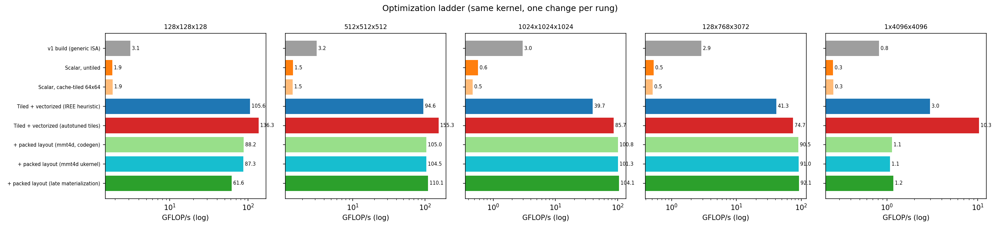
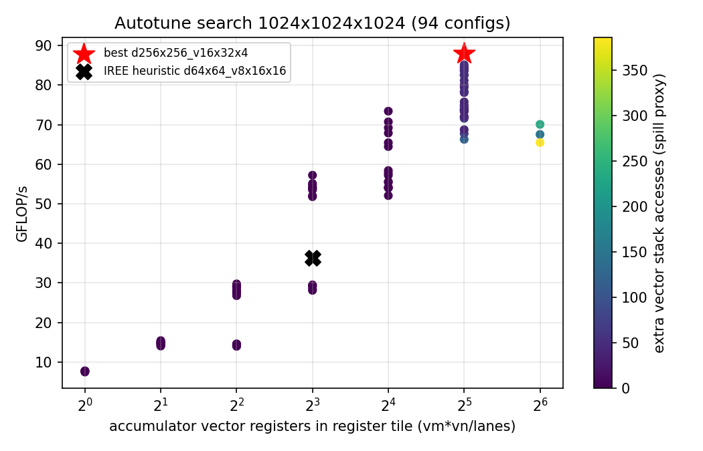
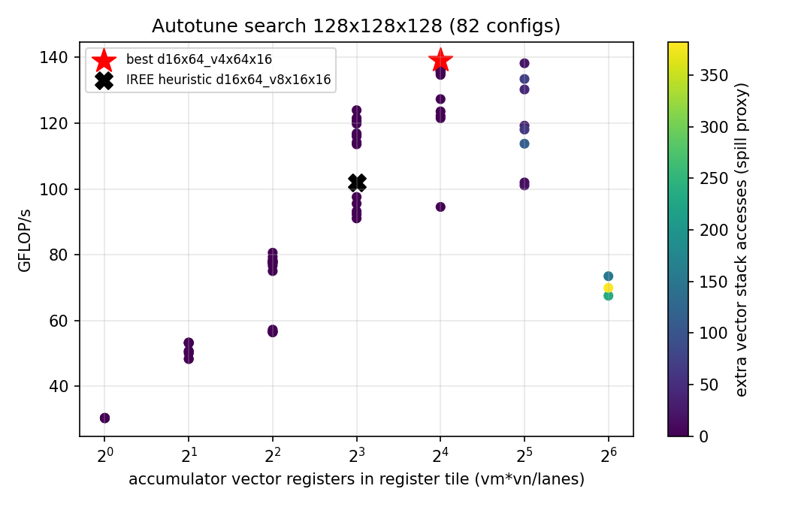
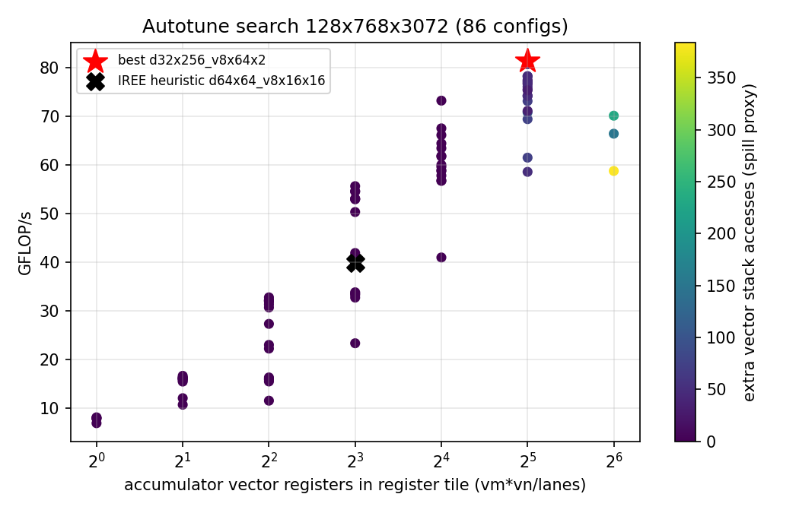
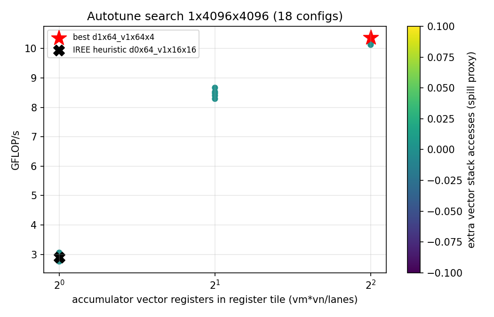
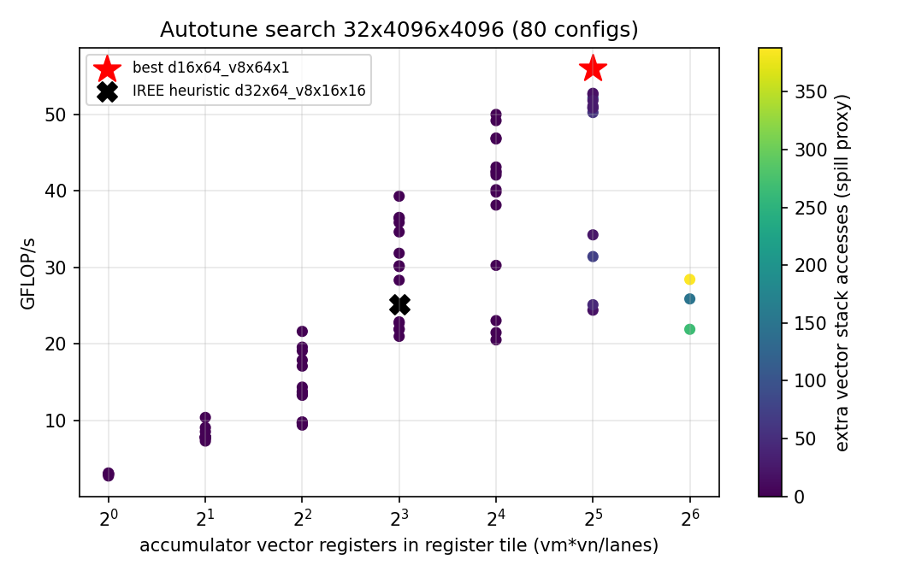
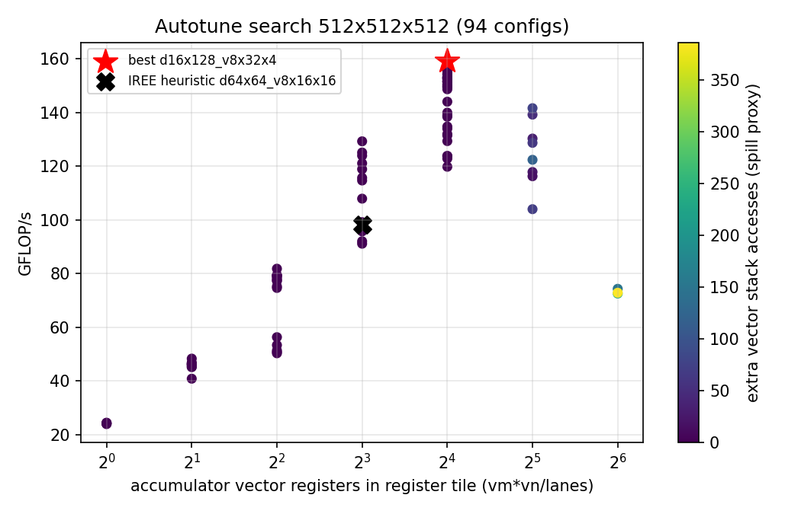
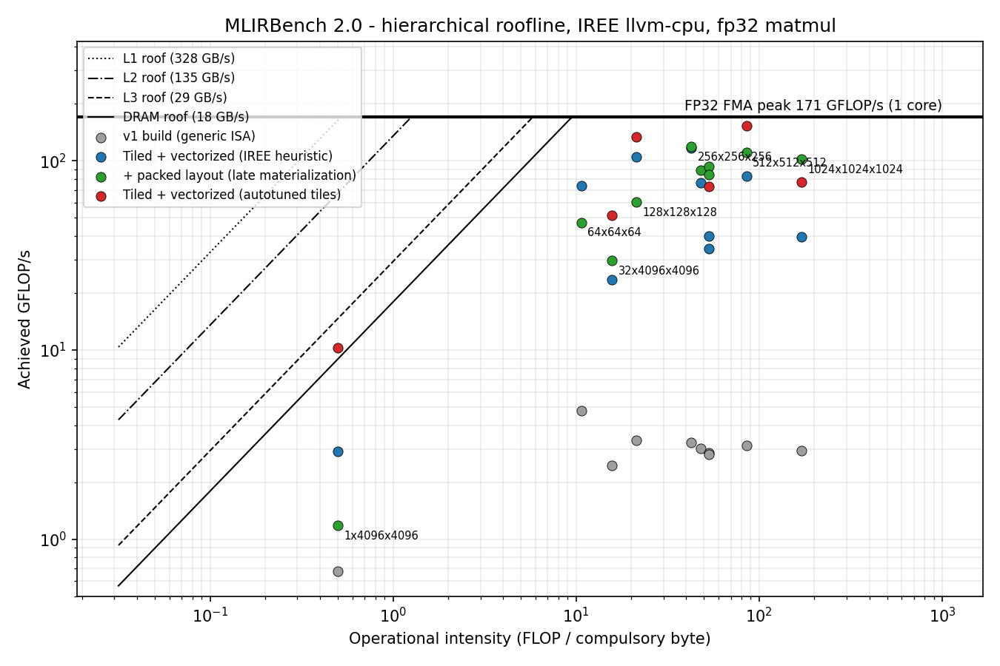

# MLIRBench 2.0 - generated results

Every number below is read from the JSON in `results/`; nothing is hand-entered. Timings are single-core (`--device=local-sync`), median across repetitions of `iree-benchmark-module`.

## Machine ceilings

Host: Intel(R) Xeon(R) Processor @ 2.10GHz (VM), IREE compiler version 3.11.0rc20260316 @ e4a3b0405d7d23554da26403658d0e8c3c5ecf25

| Ceiling | Value | Ridge point (FLOP/B) |
|---|---|---|
| FP32 FMA peak | 171.1 GFLOP/s (512-bit, 16 acc) | - |
| L1 read bandwidth | 328.2 GB/s | 0.52 |
| L2 read bandwidth | 135.3 GB/s | 1.26 |
| L3 read bandwidth | 29.4 GB/s | 5.83 |
| DRAM read bandwidth | 18.0 GB/s | 9.53 |

Cache sizes: L1 48 KiB, L2 2048 KiB, L3 266240 KiB

## Optimization ladder

Invocation floor (1x1x1 matmul, fixed per-call cost): 0.0023 ms

### 128x128x128

| Variant | Tiles | median ms | p95 ms | GFLOP/s | % governing roof | packed FMA width (static count) | vs v1 build |
|---|---|---|---|---|---|---|---|
| v1 build (generic ISA) | heuristic | 1.3323 | 1.3651 | 3.1 | 1.8% | scalar (0) | 1.00x |
| Scalar, untiled | d0x0_v0x0x0 | 2.2576 | 2.2617 | 1.9 | 1.1% | scalar (0) | 0.59x |
| Scalar, cache-tiled 64x64 | d64x64_v0x0x0 | 2.2347 | 2.2549 | 1.9 | 1.1% | scalar (0) | 0.60x |
| Tiled + vectorized (IREE heuristic) | heuristic | 0.0397 | 0.0400 | 105.6 | 61.7% | 512-bit (128) | 33.54x |
| Tiled + vectorized (autotuned tiles) | d16x64_v4x64x16 | 0.0308 | 0.0309 | 136.3 | 79.6% | 512-bit (256) | 43.29x |
| + packed layout (mmt4d, codegen) | heuristic | 0.0476 | 0.0477 | 88.2 | 51.5% | 512-bit (16) | 28.00x |
| + packed layout (mmt4d ukernel) | heuristic | 0.0481 | 0.0492 | 87.3 | 51.0% | 512-bit (16) | 27.72x |
| + packed layout (late materialization) | heuristic | 0.0681 | 0.0694 | 61.6 | 36.0% | 512-bit (16) | 19.56x |

### 512x512x512

| Variant | Tiles | median ms | p95 ms | GFLOP/s | % governing roof | packed FMA width (static count) | vs v1 build |
|---|---|---|---|---|---|---|---|
| v1 build (generic ISA) | heuristic | 84.6607 | 85.5441 | 3.2 | 1.9% | scalar (0) | 1.00x |
| Scalar, untiled | d0x0_v0x0x0 | 180.9523 | 182.7318 | 1.5 | 0.9% | scalar (0) | 0.47x |
| Scalar, cache-tiled 64x64 | d64x64_v0x0x0 | 182.6603 | 183.7512 | 1.5 | 0.9% | scalar (0) | 0.46x |
| Tiled + vectorized (IREE heuristic) | heuristic | 2.8382 | 2.8566 | 94.6 | 55.3% | 512-bit (128) | 29.83x |
| Tiled + vectorized (autotuned tiles) | d16x128_v8x32x4 | 1.7286 | 1.7475 | 155.3 | 90.8% | 512-bit (64) | 48.98x |
| + packed layout (mmt4d, codegen) | heuristic | 2.5564 | 2.6406 | 105.0 | 61.4% | 512-bit (16) | 33.12x |
| + packed layout (mmt4d ukernel) | heuristic | 2.5687 | 2.5753 | 104.5 | 61.1% | 512-bit (16) | 32.96x |
| + packed layout (late materialization) | heuristic | 2.4372 | 2.4513 | 110.1 | 64.4% | 512-bit (16) | 34.74x |

### 1024x1024x1024

| Variant | Tiles | median ms | p95 ms | GFLOP/s | % governing roof | packed FMA width (static count) | vs v1 build |
|---|---|---|---|---|---|---|---|
| v1 build (generic ISA) | heuristic | 723.1467 | 735.2164 | 3.0 | 1.7% | scalar (0) | 1.00x |
| Scalar, untiled | d0x0_v0x0x0 | 3746.2855 | 4156.5129 | 0.6 | 0.3% | scalar (0) | 0.19x |
| Scalar, cache-tiled 64x64 | d64x64_v0x0x0 | 4586.0100 | 4634.0702 | 0.5 | 0.3% | scalar (0) | 0.16x |
| Tiled + vectorized (IREE heuristic) | heuristic | 54.1514 | 55.3433 | 39.7 | 23.2% | 512-bit (128) | 13.35x |
| + packed layout (mmt4d, codegen) | heuristic | 21.3068 | 22.0242 | 100.8 | 58.9% | 512-bit (16) | 33.94x |
| + packed layout (mmt4d ukernel) | heuristic | 21.2046 | 21.9164 | 101.3 | 59.2% | 512-bit (16) | 34.10x |
| + packed layout (late materialization) | heuristic | 20.6323 | 20.8232 | 104.1 | 60.8% | 512-bit (16) | 35.05x |
| Tiled + vectorized (autotuned tiles) | d256x256_v16x32x4 | 25.0577 | 25.3272 | 85.7 | 50.1% | 512-bit (128) | 28.86x |

### 128x768x3072

| Variant | Tiles | median ms | p95 ms | GFLOP/s | % governing roof | packed FMA width (static count) | vs v1 build |
|---|---|---|---|---|---|---|---|
| v1 build (generic ISA) | heuristic | 211.1066 | 214.9902 | 2.9 | 1.7% | scalar (0) | 1.00x |
| Scalar, untiled | d0x0_v0x0x0 | 1136.6453 | 1151.6192 | 0.5 | 0.3% | scalar (0) | 0.19x |
| Scalar, cache-tiled 64x64 | d64x64_v0x0x0 | 1178.9324 | 1188.7113 | 0.5 | 0.3% | scalar (0) | 0.18x |
| Tiled + vectorized (IREE heuristic) | heuristic | 14.6414 | 14.6510 | 41.3 | 24.1% | 512-bit (128) | 14.42x |
| Tiled + vectorized (autotuned tiles) | d32x256_v8x64x2 | 8.0820 | 8.1400 | 74.7 | 43.7% | 512-bit (64) | 26.12x |
| + packed layout (mmt4d, codegen) | heuristic | 6.6741 | 6.7439 | 90.5 | 52.9% | 512-bit (16) | 31.63x |
| + packed layout (mmt4d ukernel) | heuristic | 6.6404 | 6.6537 | 91.0 | 53.2% | 512-bit (16) | 31.79x |
| + packed layout (late materialization) | heuristic | 6.5545 | 6.6419 | 92.1 | 53.8% | 512-bit (16) | 32.21x |

### 1x4096x4096

| Variant | Tiles | median ms | p95 ms | GFLOP/s | % governing roof | packed FMA width (static count) | vs v1 build |
|---|---|---|---|---|---|---|---|
| v1 build (generic ISA) | heuristic | 41.1123 | 45.2159 | 0.8 | 5.6% | scalar (0) | 1.00x |
| Scalar, untiled | d0x0_v0x0x0 | 131.8923 | 135.5504 | 0.3 | 1.7% | scalar (0) | 0.31x |
| Scalar, cache-tiled 64x64 | d1x64_v0x0x0 | 130.1429 | 133.2075 | 0.3 | 1.8% | scalar (0) | 0.32x |
| Tiled + vectorized (IREE heuristic) | heuristic | 11.2999 | 11.4516 | 3.0 | 20.2% | 512-bit (16) | 3.64x |
| + packed layout (mmt4d, codegen) | heuristic | 29.4726 | 32.8504 | 1.1 | 7.8% | 512-bit (1) | 1.39x |
| + packed layout (mmt4d ukernel) | heuristic | 31.0993 | 34.7611 | 1.1 | 7.3% | 512-bit (4) | 1.32x |
| + packed layout (late materialization) | heuristic | 28.4699 | 34.7734 | 1.2 | 8.0% | 512-bit (4) | 1.44x |
| Tiled + vectorized (autotuned tiles) | d1x64_v1x64x4 | 3.2549 | 3.3146 | 10.3 | 70.2% | 512-bit (16) | 12.63x |

## Hand-written transform-dialect schedule

`schedules/matmul.mlir.in` replaces IREE's codegen pipeline for the matmul. Each stage adds one transformation; `*` = minimum over 3 interleaved confirmation rounds. See `docs/TRANSFORM_SCHEDULE.md`.

| Stage (ms) | 128x128x128 (d16x64_v4x64x16) | 512x512x512 (d16x128_v8x32x4) | 1024x1024x1024 (d256x256_v16x32x4) |
|---|---|---|---|
| S1_tile_vectorize | 1.1339 | 49.9517 | 407.8777 |
| S2_outerproduct | 0.0367 | 2.5178 | 54.5286 |
| S3_hoist_acc | 0.0320* | 1.7742* | 29.3181* |
| S4_fuse_fill | 0.0315* | 1.7231* | 27.7156* |
| S5_kblock | 0.0327* | 1.8255* | 18.1120* |
| IREE_same_tiles | 0.0307* | 1.7587* | 25.6878* |
| IREE_packed_late | 0.0677* | 2.4138* | 21.0456* |

| Shape | best TK | full schedule vs IREE same tiles | K-blocked vs IREE same tiles | best mine vs best IREE |
|---|---|---|---|---|
| 128x128x128 | 64 | 97.5% | 94.0% | 97.5% |
| 512x512x512 | 128 | 102.1% | 96.3% | 102.1% |
| 1024x1024x1024 | 256 | 92.7% | 141.8% | 116.2% |

## Padded-width experiment (capacity vs power-of-two conflicts)

Fixed tiles across shapes: IREE `d64x64_v8x16x16`, schedule `d64x64_v16x32x4`, K blocking TK=64. Counter backend: none (timings only). See `docs/COUNTER_FINDINGS.md` section 12.

| Shape (MxKxN) | Kernel | ms | GFLOP/s |
|---|---|---|---|
| 960x960x960 | iree_fixed | 21.158 | 83.6 |
| 960x960x960 | sched_S4 | 12.415 | 142.5 |
| 960x960x960 | sched_S5 | 13.907 | 127.2 |
| 1024x1024x1024 | iree_fixed | 51.806 | 41.5 |
| 1024x1024x1024 | sched_S4 | 27.546 | 78.0 |
| 1024x1024x1024 | sched_S5 | 18.567 | 115.7 |
| 1088x1088x1088 | iree_fixed | 28.862 | 89.2 |
| 1088x1088x1088 | sched_S4 | 18.422 | 139.8 |
| 1088x1088x1088 | sched_S5 | 19.433 | 132.6 |
| 1024x1024x1088 | iree_fixed | 25.175 | 90.6 |
| 1024x1024x1088 | sched_S4 | 18.247 | 125.0 |
| 1024x1024x1088 | sched_S5 | 18.529 | 123.1 |
| 1024x1088x1024 | iree_fixed | 53.712 | 42.5 |
| 1024x1088x1024 | sched_S4 | 26.544 | 86.0 |
| 1024x1088x1024 | sched_S5 | 17.779 | 128.3 |

Verdict (mechanical):

- iree_fixed: GFLOP/s 960/1024/1088 = 83.6/41.5/89.2: 1024 runs at 0.50x its slower neighbour although 1088 is the larger problem. Pure capacity cannot produce a dip at the middle size, so a power-of-two effect dominates. Counters are needed to say at which level (L1 sets, L2 sets, or 4K aliasing).
- iree_fixed:   change only B's stride -> 2.19x the 1024^3 speed; only A's stride -> 1.02x (the one that recovers is the conflicting operand)
- sched_S4: GFLOP/s 960/1024/1088 = 142.5/78.0/139.8: 1024 runs at 0.56x its slower neighbour although 1088 is the larger problem. Pure capacity cannot produce a dip at the middle size, so a power-of-two effect dominates. Counters are needed to say at which level (L1 sets, L2 sets, or 4K aliasing).
- sched_S4:   change only B's stride -> 1.60x the 1024^3 speed; only A's stride -> 1.10x (the one that recovers is the conflicting operand)
- sched_S5: GFLOP/s 960/1024/1088 = 127.2/115.7/132.6: no dip at 1024 (0.91x); no power-of-two effect visible in timing
- sched_S5:   change only B's stride -> 1.06x the 1024^3 speed; only A's stride -> 1.11x (the one that recovers is the conflicting operand)

## Autotuner

| Shape | IREE heuristic | Autotuned | Configs | Rejected | heuristic ms | tuned ms | Speedup |
|---|---|---|---|---|---|---|---|
| 1024x1024x1024 | d64x64_v8x16x16 | d256x256_v16x32x4 | 94 | 4 | 52.9356 | 25.2249 | 2.10x |
| 128x128x128 | d16x64_v8x16x16 | d16x64_v4x64x16 | 82 | 4 | 0.0399 | 0.0310 | 1.29x |
| 128x768x3072 | d64x64_v8x16x16 | d32x256_v8x64x2 | 86 | 4 | 14.9422 | 7.9652 | 1.88x |
| 1x4096x4096 | d0x64_v1x16x16 | d1x64_v1x64x4 | 18 | 0 | 11.5516 | 3.2613 | 3.54x |
| 32x4096x4096 | d32x64_v8x16x16 | d16x64_v8x64x1 | 80 | 4 | 43.4297 | 20.5575 | 2.11x |
| 512x512x512 | d64x64_v8x16x16 | d16x128_v8x32x4 | 94 | 4 | 2.8167 | 1.7212 | 1.64x |

Speedups are from a separate confirmation run (11 repetitions, 0.2 s each) of the winner and the heuristic, not from the search itself.

## Roofline sweep

| Shape | Kind | Variant | median ms | GFLOP/s | OI | Data lives in | Roof GF/s | % roof | floor share | Diagnosis |
|---|---|---|---|---|---|---|---|---|---|---|
| 64x64x64 | square | v1 build (generic ISA) | 0.1101 | 4.8 | 10.7 | L1 | 171 | 2.8% | 2% | far below the compute roof: codegen-limited, not resource-limited |
| 64x64x64 | square | Tiled + vectorized (IREE heuristic) | 0.0071 | 74.1 | 10.7 | L1 | 171 | 43.3% | 33% | overhead-dominated (fixed invocation cost is a large share of latency) |
| 64x64x64 | square | + packed layout (late materialization) | 0.0111 | 47.2 | 10.7 | L1 | 171 | 27.6% | 21% | 28% of the compute roof: codegen headroom (tiling / layout) |
| 128x128x128 | square | v1 build (generic ISA) | 1.2596 | 3.3 | 21.3 | L2 | 171 | 1.9% | 0% | far below the compute roof: codegen-limited, not resource-limited |
| 128x128x128 | square | Tiled + vectorized (IREE heuristic) | 0.0401 | 104.7 | 21.3 | L2 | 171 | 61.2% | 6% | near the compute roof |
| 128x128x128 | square | + packed layout (late materialization) | 0.0692 | 60.6 | 21.3 | L2 | 171 | 35.4% | 3% | 35% of the compute roof: codegen headroom (tiling / layout) |
| 128x128x128 | square | Tiled + vectorized (autotuned tiles) | 0.0313 | 134.1 | 21.3 | L2 | 171 | 78.4% | 7% | near the compute roof |
| 256x256x256 | square | v1 build (generic ISA) | 10.3033 | 3.3 | 42.7 | L2 | 171 | 1.9% | 0% | far below the compute roof: codegen-limited, not resource-limited |
| 256x256x256 | square | Tiled + vectorized (IREE heuristic) | 0.2878 | 116.6 | 42.7 | L2 | 171 | 68.1% | 1% | near the compute roof |
| 256x256x256 | square | + packed layout (late materialization) | 0.2816 | 119.1 | 42.7 | L2 | 171 | 69.6% | 1% | near the compute roof |
| 512x512x512 | square | v1 build (generic ISA) | 85.4255 | 3.1 | 85.3 | L3 | 171 | 1.8% | 0% | far below the compute roof: codegen-limited, not resource-limited |
| 512x512x512 | square | Tiled + vectorized (IREE heuristic) | 3.2203 | 83.4 | 85.3 | L3 | 171 | 48.7% | 0% | 49% of the compute roof: codegen headroom (tiling / layout) |
| 512x512x512 | square | + packed layout (late materialization) | 2.4323 | 110.4 | 85.3 | L3 | 171 | 64.5% | 0% | near the compute roof |
| 512x512x512 | square | Tiled + vectorized (autotuned tiles) | 1.7524 | 153.2 | 85.3 | L3 | 171 | 89.5% | 0% | near the compute roof |
| 1024x1024x1024 | square | v1 build (generic ISA) | 731.3093 | 2.9 | 170.7 | L3 | 171 | 1.7% | 0% | far below the compute roof: codegen-limited, not resource-limited |
| 1024x1024x1024 | square | Tiled + vectorized (IREE heuristic) | 54.2744 | 39.6 | 170.7 | L3 | 171 | 23.1% | 0% | far below the compute roof: codegen-limited, not resource-limited |
| 1024x1024x1024 | square | + packed layout (late materialization) | 21.0366 | 102.1 | 170.7 | L3 | 171 | 59.7% | 0% | 60% of the compute roof: codegen headroom (tiling / layout) |
| 1024x1024x1024 | square | Tiled + vectorized (autotuned tiles) | 27.6999 | 77.5 | 170.7 | L3 | 171 | 45.3% | 0% | 45% of the compute roof: codegen headroom (tiling / layout) |
| 128x768x768 | attn proj, 128 tok | v1 build (generic ISA) | 49.9575 | 3.0 | 48.0 | L3 | 171 | 1.8% | 0% | far below the compute roof: codegen-limited, not resource-limited |
| 128x768x768 | attn proj, 128 tok | Tiled + vectorized (IREE heuristic) | 1.9709 | 76.6 | 48.0 | L3 | 171 | 44.8% | 0% | 45% of the compute roof: codegen headroom (tiling / layout) |
| 128x768x768 | attn proj, 128 tok | + packed layout (late materialization) | 1.6859 | 89.6 | 48.0 | L3 | 171 | 52.3% | 0% | 52% of the compute roof: codegen headroom (tiling / layout) |
| 128x768x3072 | FFN up, 128 tok | v1 build (generic ISA) | 210.9531 | 2.9 | 53.0 | L3 | 171 | 1.7% | 0% | far below the compute roof: codegen-limited, not resource-limited |
| 128x768x3072 | FFN up, 128 tok | Tiled + vectorized (IREE heuristic) | 15.1188 | 39.9 | 53.0 | L3 | 171 | 23.3% | 0% | far below the compute roof: codegen-limited, not resource-limited |
| 128x768x3072 | FFN up, 128 tok | + packed layout (late materialization) | 6.4816 | 93.2 | 53.0 | L3 | 171 | 54.5% | 0% | 54% of the compute roof: codegen headroom (tiling / layout) |
| 128x768x3072 | FFN up, 128 tok | Tiled + vectorized (autotuned tiles) | 8.2232 | 73.4 | 53.0 | L3 | 171 | 42.9% | 0% | 43% of the compute roof: codegen headroom (tiling / layout) |
| 128x3072x768 | FFN down, 128 tok | v1 build (generic ISA) | 215.7196 | 2.8 | 53.0 | L3 | 171 | 1.6% | 0% | far below the compute roof: codegen-limited, not resource-limited |
| 128x3072x768 | FFN down, 128 tok | Tiled + vectorized (IREE heuristic) | 17.6045 | 34.3 | 53.0 | L3 | 171 | 20.0% | 0% | far below the compute roof: codegen-limited, not resource-limited |
| 128x3072x768 | FFN down, 128 tok | + packed layout (late materialization) | 7.1731 | 84.2 | 53.0 | L3 | 171 | 49.2% | 0% | 49% of the compute roof: codegen headroom (tiling / layout) |
| 32x4096x4096 | decode, batch 32 | v1 build (generic ISA) | 437.6794 | 2.5 | 15.8 | L3 | 171 | 1.4% | 0% | far below the compute roof: codegen-limited, not resource-limited |
| 32x4096x4096 | decode, batch 32 | Tiled + vectorized (IREE heuristic) | 45.5502 | 23.6 | 15.8 | L3 | 171 | 13.8% | 0% | far below the compute roof: codegen-limited, not resource-limited |
| 32x4096x4096 | decode, batch 32 | + packed layout (late materialization) | 36.0215 | 29.8 | 15.8 | L3 | 171 | 17.4% | 0% | far below the compute roof: codegen-limited, not resource-limited |
| 32x4096x4096 | decode, batch 32 | Tiled + vectorized (autotuned tiles) | 20.9022 | 51.4 | 15.8 | L3 | 171 | 30.0% | 0% | 30% of the compute roof: codegen headroom (tiling / layout) |
| 1x4096x4096 | decode GEMV, batch 1 | v1 build (generic ISA) | 49.3514 | 0.7 | 0.5 | L3 | 15 | 4.6% | 0% | far below the L3 bandwidth roof: codegen-limited, not resource-limited |
| 1x4096x4096 | decode GEMV, batch 1 | Tiled + vectorized (IREE heuristic) | 11.5159 | 2.9 | 0.5 | L3 | 15 | 19.8% | 0% | far below the L3 bandwidth roof: codegen-limited, not resource-limited |
| 1x4096x4096 | decode GEMV, batch 1 | + packed layout (late materialization) | 28.3867 | 1.2 | 0.5 | L3 | 15 | 8.1% | 0% | far below the L3 bandwidth roof: codegen-limited, not resource-limited |
| 1x4096x4096 | decode GEMV, batch 1 | Tiled + vectorized (autotuned tiles) | 3.2633 | 10.3 | 0.5 | L3 | 15 | 70.0% | 0% | near the L3 bandwidth roof |

## Hardware counters

Availability: NOT available - hardware events not supported (no PMU exposed - typical of VMs). [    0.526191] Performance Events: unsupported CPU family 6 model 207 no PMU driver, software events only.

Per-invocation counts (iteration-differenced):

| Shape | Variant | backend | context-switches | page-faults | task-clock |
|---|---|---|---|---|---|
| 128x128x128 | scalar_naive | None | -0.010 | -0.030 | 2.261 |
| 128x128x128 | vec_heuristic | None | 0.020 | -0.050 | 0.033 |
| 128x128x128 | vec_autotuned | None | -0.100 | 0.000 | 0.016 |
| 128x128x128 | packed_late | None | 0.080 | 16.010 | 0.066 |

## Thermal guard

Baseline probe 167.6 GFLOP/s, probe noise 0.2%, flag threshold 5.0%. 24 probes, 0 below threshold, 0 s spent cooling.

No result was measured while throttled.

## RISC-V (RVV) - cross-compiled and executed under QEMU

| Build | Shape | vmfb bytes | RVV FMA (static) | scalar FMA (static) | vsetvl | QEMU cpu | Result |
|---|---|---|---|---|---|---|---|
| rv64gcv | 128x128x128 | 10337 | 9 | 13 | 1 | rv64,v=true,vext_spec=v1.0,vlen=128 | PASS |
| rv64gcv | 128x128x128 | 10337 | 9 | 13 | 1 | rv64,v=true,vext_spec=v1.0,vlen=256 | PASS |
| rv64gcv | 128x128x128 | 10337 | 9 | 13 | 1 | rv64,v=true,vext_spec=v1.0,vlen=512 | PASS |
| rv64gcv | 128x128x128 | 10337 | 9 | 13 | 1 | rv64,v=false | SIGILL |
| rv64gc | 128x128x128 | 16449 | 0 | 269 | 0 | rv64,v=false | PASS |
| rv64gcv | 64x96x80 | 10361 | 11 | 13 | 1 | rv64,v=true,vext_spec=v1.0,vlen=128 | PASS |
| rv64gcv | 64x96x80 | 10361 | 11 | 13 | 1 | rv64,v=true,vext_spec=v1.0,vlen=256 | PASS |
| rv64gcv | 64x96x80 | 10361 | 11 | 13 | 1 | rv64,v=true,vext_spec=v1.0,vlen=512 | PASS |
| rv64gcv | 64x96x80 | 10361 | 11 | 13 | 1 | rv64,v=false | SIGILL |
| rv64gc | 64x96x80 | 18449 | 0 | 333 | 0 | rv64,v=false | PASS |

QEMU is functional emulation: these rows establish correctness and ISA usage, not RISC-V performance.
