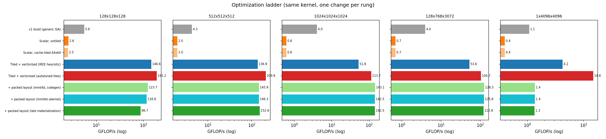
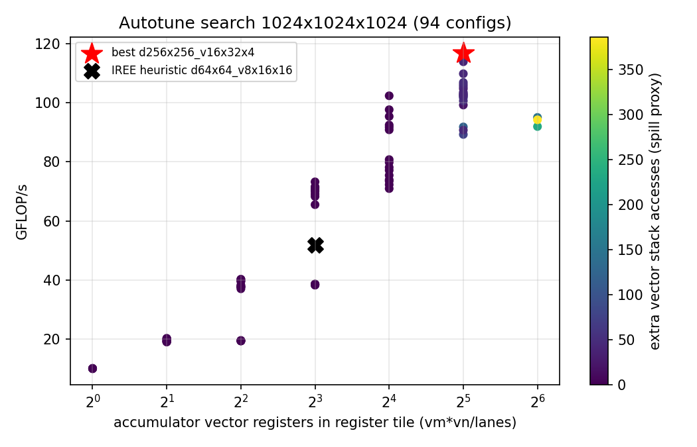
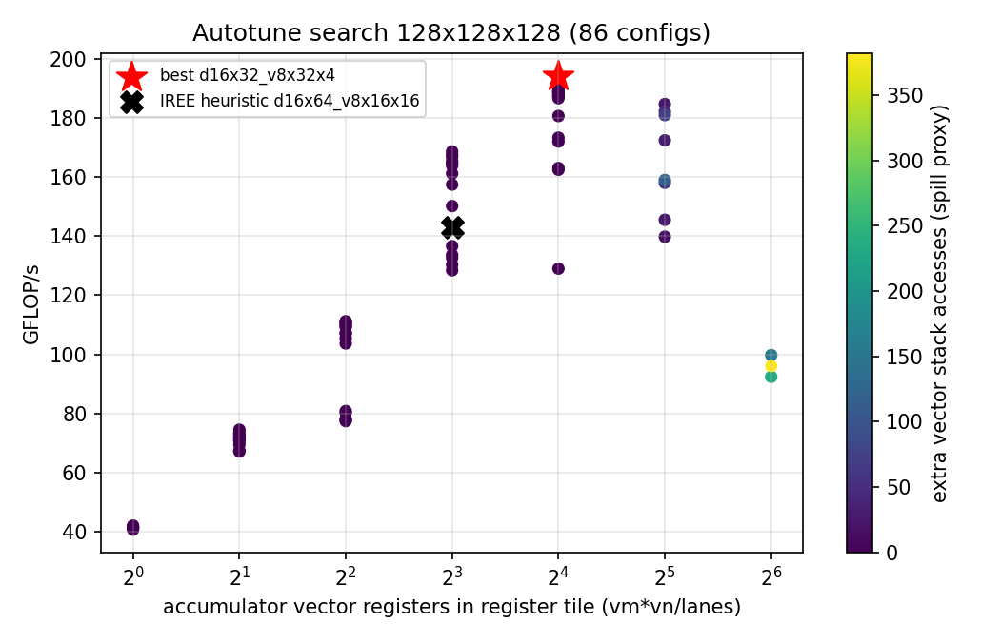
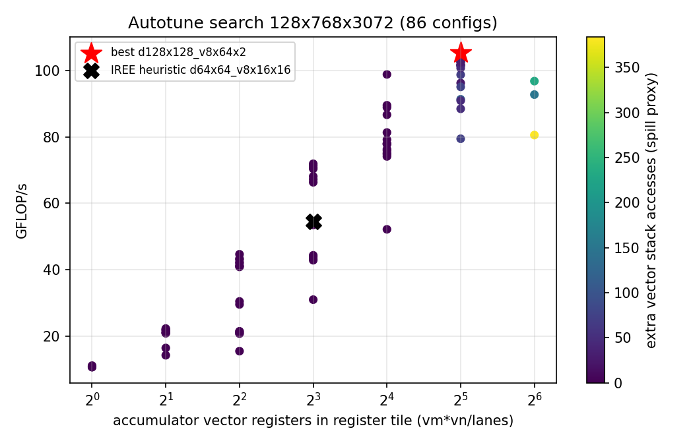
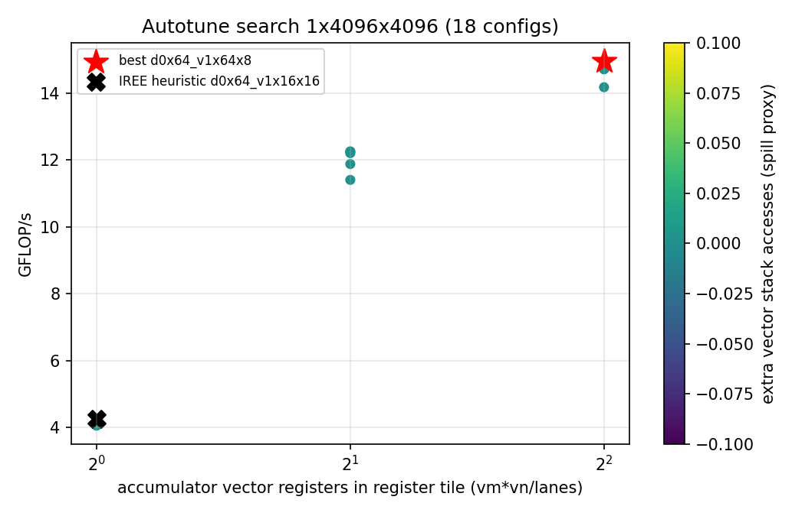
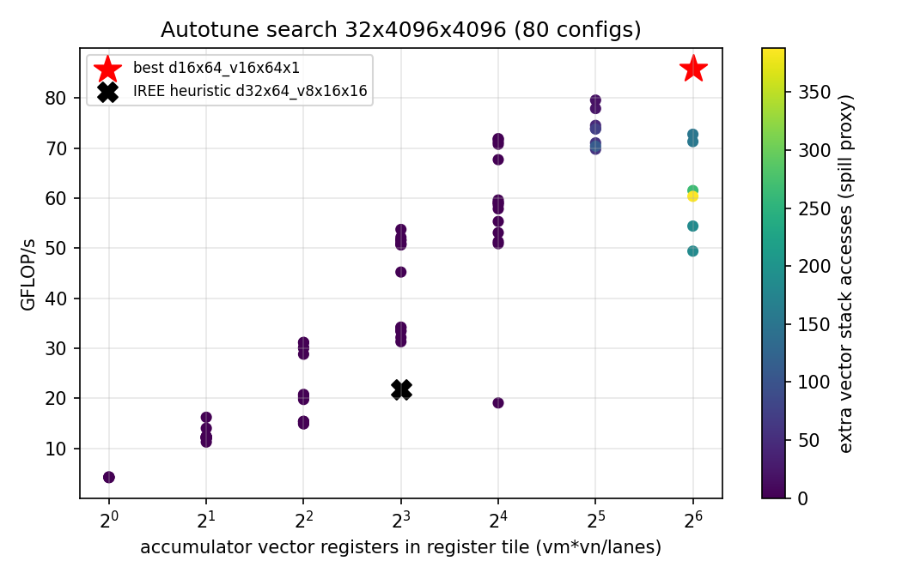
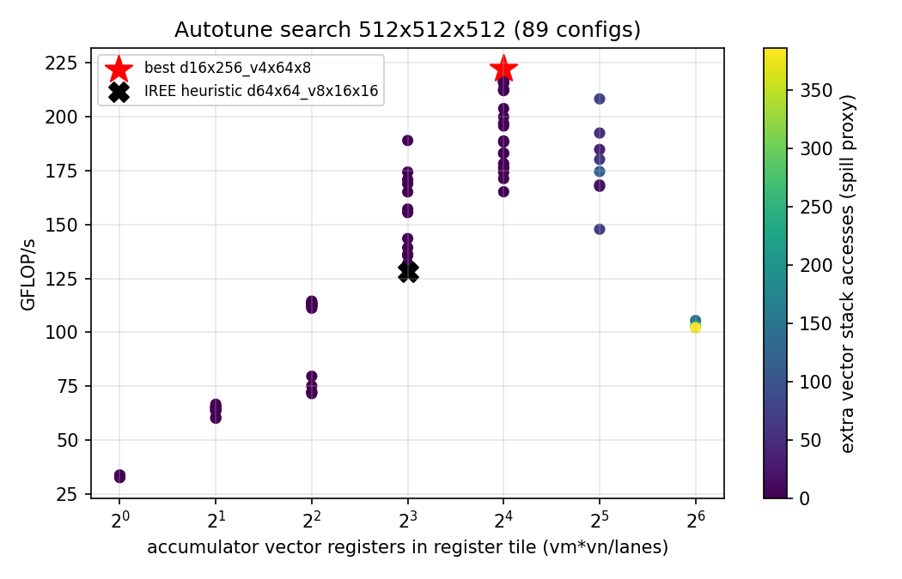
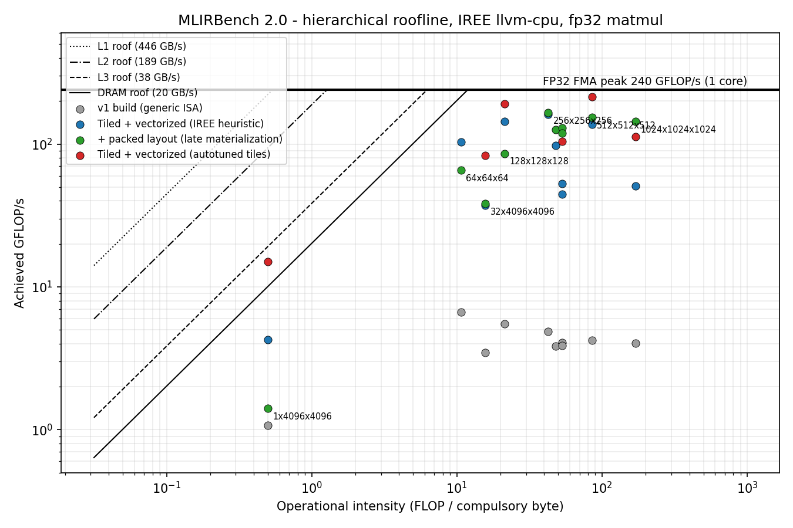

# MLIRBench 2.0 - generated results

Every number below is read from the JSON in `results/`; nothing is hand-entered. Timings are single-core (`--device=local-sync`), median across repetitions of `iree-benchmark-module`.

## Machine ceilings

Host: INTEL(R) XEON(R) PLATINUM 8581C CPU @ 2.30GHz (VM), IREE compiler version 3.11.0rc20260316 @ e4a3b0405d7d23554da26403658d0e8c3c5ecf25

| Ceiling | Value | Ridge point (FLOP/B) |
|---|---|---|
| FP32 FMA peak | 240.2 GFLOP/s (512-bit, 12 acc) | - |
| L1 read bandwidth | 446.2 GB/s | 0.54 |
| L2 read bandwidth | 188.5 GB/s | 1.27 |
| L3 read bandwidth | 38.4 GB/s | 6.25 |
| DRAM read bandwidth | 20.2 GB/s | 11.91 |

Cache sizes: L1 48 KiB, L2 2048 KiB, L3 266240 KiB

## Optimization ladder

Invocation floor (1x1x1 matmul, fixed per-call cost): 0.0017 ms

### 128x128x128

| Variant | Tiles | median ms | p95 ms | GFLOP/s | % governing roof | packed FMA width (static count) | vs v1 build |
|---|---|---|---|---|---|---|---|
| v1 build (generic ISA) | heuristic | 0.7540 | 0.7829 | 5.6 | 2.3% | scalar (0) | 1.00x |
| Scalar, untiled | d0x0_v0x0x0 | 1.6288 | 1.6650 | 2.6 | 1.1% | scalar (0) | 0.46x |
| Scalar, cache-tiled 64x64 | d64x64_v0x0x0 | 1.6530 | 1.6720 | 2.5 | 1.1% | scalar (0) | 0.46x |
| Tiled + vectorized (IREE heuristic) | heuristic | 0.0286 | 0.0289 | 146.6 | 61.0% | 512-bit (128) | 26.35x |
| Tiled + vectorized (autotuned tiles) | d16x32_v8x32x4 | 0.0219 | 0.0228 | 191.2 | 79.6% | 512-bit (64) | 34.38x |
| + packed layout (mmt4d, codegen) | heuristic | 0.0339 | 0.0347 | 123.7 | 51.5% | 512-bit (16) | 22.25x |
| + packed layout (mmt4d ukernel) | heuristic | 0.0359 | 0.0365 | 116.8 | 48.6% | 512-bit (16) | 21.00x |
| + packed layout (late materialization) | heuristic | 0.0484 | 0.0490 | 86.7 | 36.1% | 512-bit (16) | 15.58x |

### 512x512x512

| Variant | Tiles | median ms | p95 ms | GFLOP/s | % governing roof | packed FMA width (static count) | vs v1 build |
|---|---|---|---|---|---|---|---|
| v1 build (generic ISA) | heuristic | 62.1058 | 63.1545 | 4.3 | 1.8% | scalar (0) | 1.00x |
| Scalar, untiled | d0x0_v0x0x0 | 133.1656 | 136.3451 | 2.0 | 0.8% | scalar (0) | 0.47x |
| Scalar, cache-tiled 64x64 | d64x64_v0x0x0 | 132.6244 | 137.4494 | 2.0 | 0.8% | scalar (0) | 0.47x |
| Tiled + vectorized (IREE heuristic) | heuristic | 1.9606 | 2.0141 | 136.9 | 57.0% | 512-bit (128) | 31.68x |
| Tiled + vectorized (autotuned tiles) | d32x128_v8x32x8 | 1.2792 | 1.2862 | 209.9 | 87.4% | 512-bit (128) | 48.55x |
| + packed layout (mmt4d, codegen) | heuristic | 1.8399 | 1.8980 | 145.9 | 60.7% | 512-bit (16) | 33.75x |
| + packed layout (mmt4d ukernel) | heuristic | 1.8342 | 1.8858 | 146.3 | 60.9% | 512-bit (16) | 33.86x |
| + packed layout (late materialization) | heuristic | 1.7593 | 1.7839 | 152.6 | 63.5% | 512-bit (16) | 35.30x |

### 1024x1024x1024

| Variant | Tiles | median ms | p95 ms | GFLOP/s | % governing roof | packed FMA width (static count) | vs v1 build |
|---|---|---|---|---|---|---|---|
| v1 build (generic ISA) | heuristic | 531.1741 | 540.6623 | 4.0 | 1.7% | scalar (0) | 1.00x |
| Scalar, untiled | d0x0_v0x0x0 | 3451.8558 | 3464.2561 | 0.6 | 0.3% | scalar (0) | 0.15x |
| Scalar, cache-tiled 64x64 | d64x64_v0x0x0 | 3452.0223 | 3466.3901 | 0.6 | 0.3% | scalar (0) | 0.15x |
| Tiled + vectorized (IREE heuristic) | heuristic | 41.4668 | 41.7349 | 51.8 | 21.6% | 512-bit (128) | 12.81x |
| Tiled + vectorized (autotuned tiles) | d64x64_v16x32x4 | 18.8861 | 20.2804 | 113.7 | 47.3% | 512-bit (128) | 28.13x |
| + packed layout (mmt4d, codegen) | heuristic | 15.0045 | 15.2664 | 143.1 | 59.6% | 512-bit (16) | 35.40x |
| + packed layout (mmt4d ukernel) | heuristic | 15.0735 | 15.3363 | 142.5 | 59.3% | 512-bit (16) | 35.24x |
| + packed layout (late materialization) | heuristic | 15.0744 | 15.3608 | 142.5 | 59.3% | 512-bit (16) | 35.24x |

### 128x768x3072

| Variant | Tiles | median ms | p95 ms | GFLOP/s | % governing roof | packed FMA width (static count) | vs v1 build |
|---|---|---|---|---|---|---|---|
| v1 build (generic ISA) | heuristic | 152.7243 | 158.8722 | 4.0 | 1.6% | scalar (0) | 1.00x |
| Scalar, untiled | d0x0_v0x0x0 | 867.9510 | 871.4542 | 0.7 | 0.3% | scalar (0) | 0.18x |
| Scalar, cache-tiled 64x64 | d64x64_v0x0x0 | 865.3767 | 869.9680 | 0.7 | 0.3% | scalar (0) | 0.18x |
| Tiled + vectorized (IREE heuristic) | heuristic | 11.2597 | 11.3849 | 53.6 | 22.3% | 512-bit (128) | 13.56x |
| Tiled + vectorized (autotuned tiles) | d128x128_v8x64x2 | 5.7682 | 5.8570 | 104.7 | 43.6% | 512-bit (64) | 26.48x |
| + packed layout (mmt4d, codegen) | heuristic | 4.7729 | 4.8407 | 126.5 | 52.7% | 512-bit (16) | 32.00x |
| + packed layout (mmt4d ukernel) | heuristic | 4.7995 | 4.8213 | 125.8 | 52.4% | 512-bit (16) | 31.82x |
| + packed layout (late materialization) | heuristic | 4.9166 | 5.0606 | 122.8 | 51.1% | 512-bit (16) | 31.06x |

### 1x4096x4096

| Variant | Tiles | median ms | p95 ms | GFLOP/s | % governing roof | packed FMA width (static count) | vs v1 build |
|---|---|---|---|---|---|---|---|
| v1 build (generic ISA) | heuristic | 30.9829 | 31.3622 | 1.1 | 5.6% | scalar (0) | 1.00x |
| Scalar, untiled | d0x0_v0x0x0 | 84.2950 | 86.8906 | 0.4 | 2.1% | scalar (0) | 0.37x |
| Scalar, cache-tiled 64x64 | d1x64_v0x0x0 | 84.7802 | 85.0974 | 0.4 | 2.1% | scalar (0) | 0.37x |
| Tiled + vectorized (IREE heuristic) | heuristic | 7.9439 | 8.4751 | 4.2 | 22.0% | 512-bit (16) | 3.90x |
| Tiled + vectorized (autotuned tiles) | d0x64_v1x64x8 | 2.2635 | 2.2659 | 14.8 | 77.2% | 512-bit (32) | 13.69x |
| + packed layout (mmt4d, codegen) | heuristic | 24.5652 | 28.0489 | 1.4 | 7.1% | 512-bit (1) | 1.26x |
| + packed layout (mmt4d ukernel) | heuristic | 24.5866 | 28.5474 | 1.4 | 7.1% | 512-bit (4) | 1.26x |
| + packed layout (late materialization) | heuristic | 25.1193 | 27.4598 | 1.3 | 7.0% | 512-bit (4) | 1.23x |

## Hand-written transform-dialect schedule

`schedules/matmul.mlir.in` replaces IREE's codegen pipeline for the matmul. Each stage adds one transformation; `*` = minimum over 3 interleaved confirmation rounds. See `docs/TRANSFORM_SCHEDULE.md`.

| Stage (ms) | 128x128x128 (d16x32_v8x32x4) | 512x512x512 (d32x128_v8x32x8) | 1024x1024x1024 (d64x64_v16x32x4) |
|---|---|---|---|
| S1_tile_vectorize | 0.5550 | 36.8172 | 281.4973 |
| S2_outerproduct | 0.0291 | 1.5269 | 39.2206 |
| S3_hoist_acc | 0.0219* | 1.2338* | 21.9897* |
| S4_fuse_fill | 0.0212* | 1.2084* | 20.5123* |
| S5_kblock | 0.0221* | 1.2478* | 14.1755* |
| IREE_same_tiles | 0.0211* | 1.2029* | 18.5576* |
| IREE_packed_late | 0.0464* | 1.6912* | 14.2888* |

| Shape | best TK | full schedule vs IREE same tiles | K-blocked vs IREE same tiles | best mine vs best IREE |
|---|---|---|---|---|
| 128x128x128 | 64 | 99.8% | 95.6% | 99.8% |
| 512x512x512 | 256 | 99.5% | 96.4% | 99.5% |
| 1024x1024x1024 | 128 | 90.5% | 130.9% | 100.8% |

## Padded-width experiment (capacity vs power-of-two conflicts)

Fixed tiles across shapes: IREE `d64x64_v8x16x16`, schedule `d64x64_v16x32x4`, K blocking TK=64. Counter backend: perf. See `docs/COUNTER_FINDINGS.md` section 12.

| Shape (MxKxN) | Kernel | ms | GFLOP/s | L2 miss/kFLOP | L1 miss/kFLOP | L2-stall frac |
|---|---|---|---|---|---|---|
| 960x960x960 | iree_fixed | 17.659 | 100.2 | 0.649 | 3.808 | 0.128 |
| 960x960x960 | sched_S4 | 11.082 | 159.7 | 0.597 | 0.460 | 0.066 |
| 960x960x960 | sched_S5 | 12.332 | 143.5 | 0.596 | 0.708 | 0.128 |
| 1024x1024x1024 | iree_fixed | 43.245 | 49.7 | 4.041 | 3.272 | 0.566 |
| 1024x1024x1024 | sched_S4 | 21.671 | 99.1 | 2.103 | 4.018 | 0.340 |
| 1024x1024x1024 | sched_S5 | 16.417 | 130.8 | 2.376 | 3.825 | 0.086 |
| 1088x1088x1088 | iree_fixed | 25.912 | 99.4 | 0.633 | 3.585 | 0.126 |
| 1088x1088x1088 | sched_S4 | 16.909 | 152.3 | 0.589 | 0.410 | 0.092 |
| 1088x1088x1088 | sched_S5 | 17.053 | 151.0 | 0.584 | 0.685 | 0.070 |
| 1024x1024x1088 | iree_fixed | 23.257 | 98.1 | 0.642 | 3.960 | 0.122 |
| 1024x1024x1088 | sched_S4 | 16.613 | 137.3 | 0.592 | 4.133 | 0.134 |
| 1024x1024x1088 | sched_S5 | 16.280 | 140.2 | 0.620 | 3.500 | 0.066 |
| 1024x1088x1024 | iree_fixed | 46.251 | 49.3 | 4.066 | 3.120 | 0.572 |
| 1024x1088x1024 | sched_S4 | 22.911 | 99.6 | 2.108 | 0.595 | 0.358 |
| 1024x1088x1024 | sched_S5 | 15.667 | 145.6 | 1.692 | 1.154 | 0.088 |

Verdict (mechanical):

- iree_fixed: L2 misses/kFLOP 960/1024/1088 = 0.65/4.04/0.63 -> 1024 is an outlier (6.2x the worse neighbour): supports the power-of-two SET-CONFLICT hypothesis
- iree_fixed:   L1 misses/kFLOP 960/1024/1088 = 3.81/3.27/3.59 (1024 = 0.86x the worse neighbour)
- iree_fixed:   L2-miss stall fraction 960/1024/1088 = 0.128/0.566/0.126 (1024 = 4.43x the worse neighbour)
- iree_fixed:   change only B's stride -> 0.16x of 1024^3; only A's stride -> 1.01x (the one that drops is the conflicting operand)
- sched_S4: L2 misses/kFLOP 960/1024/1088 = 0.60/2.10/0.59 -> 1024 is an outlier (3.5x the worse neighbour): supports the power-of-two SET-CONFLICT hypothesis
- sched_S4:   L1 misses/kFLOP 960/1024/1088 = 0.46/4.02/0.41 (1024 = 8.73x the worse neighbour)
- sched_S4:   L2-miss stall fraction 960/1024/1088 = 0.0664/0.34/0.092 (1024 = 3.69x the worse neighbour)
- sched_S4:   change only B's stride -> 0.28x of 1024^3; only A's stride -> 1.00x (the one that drops is the conflicting operand)
- sched_S5: L2 misses/kFLOP 960/1024/1088 = 0.60/2.38/0.58 -> 1024 is an outlier (4.0x the worse neighbour): supports the power-of-two SET-CONFLICT hypothesis
- sched_S5:   L1 misses/kFLOP 960/1024/1088 = 0.708/3.83/0.685 (1024 = 5.40x the worse neighbour)
- sched_S5:   L2-miss stall fraction 960/1024/1088 = 0.128/0.0865/0.0699 (1024 = 0.68x the worse neighbour)
- sched_S5:   change only B's stride -> 0.26x of 1024^3; only A's stride -> 0.71x (the one that drops is the conflicting operand)
- K blocking speedup (S5 vs S4) 960/1024/1088 = 0.90/1.32/0.99x: gains only at 1024^3 -> K blocking's gain is specific to the power-of-two stride
-   at 1024^3: L2 misses/kFLOP S4->S5 2.10->2.38 (0.89x), L2-miss stall fraction 0.34->0.09 (3.93x): K blocking works by making the conflict misses cheaper (far fewer stall cycles), NOT by removing them

## Autotuner

| Shape | IREE heuristic | Autotuned | Configs | Rejected | heuristic ms | tuned ms | Speedup |
|---|---|---|---|---|---|---|---|
| 1024x1024x1024 | d64x64_v8x16x16 | d256x256_v16x32x4 | 94 | 4 | 41.0983 | 18.4230 | 2.23x |
| 128x128x128 | d16x64_v8x16x16 | d16x32_v8x32x4 | 86 | 4 | 0.0280 | 0.0221 | 1.27x |
| 128x768x3072 | d64x64_v8x16x16 | d128x128_v8x64x2 | 86 | 4 | 11.4351 | 5.7904 | 1.97x |
| 1x4096x4096 | d0x64_v1x16x16 | d0x64_v1x64x8 | 18 | 0 | 7.9571 | 2.2429 | 3.55x |
| 32x4096x4096 | d32x64_v8x16x16 | d16x64_v16x64x1 | 80 | 4 | 28.3387 | 12.5690 | 2.25x |
| 512x512x512 | d64x64_v8x16x16 | d16x256_v4x64x8 | 89 | 4 | 2.1640 | 1.2843 | 1.68x |

Speedups are from a separate confirmation run (11 repetitions, 0.2 s each) of the winner and the heuristic, not from the search itself.

## Roofline sweep

| Shape | Kind | Variant | median ms | GFLOP/s | OI | Data lives in | Roof GF/s | % roof | floor share | Diagnosis |
|---|---|---|---|---|---|---|---|---|---|---|
| 64x64x64 | square | v1 build (generic ISA) | 0.0787 | 6.7 | 10.7 | L1 | 240 | 2.8% | 2% | far below the compute roof: codegen-limited, not resource-limited |
| 64x64x64 | square | Tiled + vectorized (IREE heuristic) | 0.0051 | 103.5 | 10.7 | L1 | 240 | 43.1% | 33% | overhead-dominated (fixed invocation cost is a large share of latency) |
| 64x64x64 | square | + packed layout (late materialization) | 0.0080 | 65.5 | 10.7 | L1 | 240 | 27.3% | 21% | 27% of the compute roof: codegen headroom (tiling / layout) |
| 128x128x128 | square | v1 build (generic ISA) | 0.7640 | 5.5 | 21.3 | L2 | 240 | 2.3% | 0% | far below the compute roof: codegen-limited, not resource-limited |
| 128x128x128 | square | Tiled + vectorized (IREE heuristic) | 0.0291 | 144.3 | 21.3 | L2 | 240 | 60.1% | 6% | near the compute roof |
| 128x128x128 | square | + packed layout (late materialization) | 0.0489 | 85.8 | 21.3 | L2 | 240 | 35.7% | 3% | 36% of the compute roof: codegen headroom (tiling / layout) |
| 128x128x128 | square | Tiled + vectorized (autotuned tiles) | 0.0219 | 191.4 | 21.3 | L2 | 240 | 79.7% | 8% | near the compute roof |
| 256x256x256 | square | v1 build (generic ISA) | 6.8584 | 4.9 | 42.7 | L2 | 240 | 2.0% | 0% | far below the compute roof: codegen-limited, not resource-limited |
| 256x256x256 | square | Tiled + vectorized (IREE heuristic) | 0.2075 | 161.7 | 42.7 | L2 | 240 | 67.3% | 1% | near the compute roof |
| 256x256x256 | square | + packed layout (late materialization) | 0.2030 | 165.3 | 42.7 | L2 | 240 | 68.8% | 1% | near the compute roof |
| 512x512x512 | square | v1 build (generic ISA) | 63.3911 | 4.2 | 85.3 | L3 | 240 | 1.8% | 0% | far below the compute roof: codegen-limited, not resource-limited |
| 512x512x512 | square | Tiled + vectorized (IREE heuristic) | 1.9627 | 136.8 | 85.3 | L3 | 240 | 56.9% | 0% | 57% of the compute roof: codegen headroom (tiling / layout) |
| 512x512x512 | square | + packed layout (late materialization) | 1.7457 | 153.8 | 85.3 | L3 | 240 | 64.0% | 0% | near the compute roof |
| 512x512x512 | square | Tiled + vectorized (autotuned tiles) | 1.2589 | 213.2 | 85.3 | L3 | 240 | 88.8% | 0% | near the compute roof |
| 1024x1024x1024 | square | v1 build (generic ISA) | 532.5489 | 4.0 | 170.7 | L3 | 240 | 1.7% | 0% | far below the compute roof: codegen-limited, not resource-limited |
| 1024x1024x1024 | square | Tiled + vectorized (IREE heuristic) | 42.2079 | 50.9 | 170.7 | L3 | 240 | 21.2% | 0% | far below the compute roof: codegen-limited, not resource-limited |
| 1024x1024x1024 | square | + packed layout (late materialization) | 14.8923 | 144.2 | 170.7 | L3 | 240 | 60.0% | 0% | near the compute roof |
| 1024x1024x1024 | square | Tiled + vectorized (autotuned tiles) | 19.0552 | 112.7 | 170.7 | L3 | 240 | 46.9% | 0% | 47% of the compute roof: codegen headroom (tiling / layout) |
| 128x768x768 | attn proj, 128 tok | v1 build (generic ISA) | 39.1879 | 3.9 | 48.0 | L3 | 240 | 1.6% | 0% | far below the compute roof: codegen-limited, not resource-limited |
| 128x768x768 | attn proj, 128 tok | Tiled + vectorized (IREE heuristic) | 1.5405 | 98.0 | 48.0 | L3 | 240 | 40.8% | 0% | 41% of the compute roof: codegen headroom (tiling / layout) |
| 128x768x768 | attn proj, 128 tok | + packed layout (late materialization) | 1.1945 | 126.4 | 48.0 | L3 | 240 | 52.6% | 0% | 53% of the compute roof: codegen headroom (tiling / layout) |
| 128x768x3072 | FFN up, 128 tok | v1 build (generic ISA) | 148.2597 | 4.1 | 53.0 | L3 | 240 | 1.7% | 0% | far below the compute roof: codegen-limited, not resource-limited |
| 128x768x3072 | FFN up, 128 tok | Tiled + vectorized (IREE heuristic) | 11.4149 | 52.9 | 53.0 | L3 | 240 | 22.0% | 0% | far below the compute roof: codegen-limited, not resource-limited |
| 128x768x3072 | FFN up, 128 tok | + packed layout (late materialization) | 4.6414 | 130.1 | 53.0 | L3 | 240 | 54.2% | 0% | 54% of the compute roof: codegen headroom (tiling / layout) |
| 128x768x3072 | FFN up, 128 tok | Tiled + vectorized (autotuned tiles) | 5.7836 | 104.4 | 53.0 | L3 | 240 | 43.5% | 0% | 43% of the compute roof: codegen headroom (tiling / layout) |
| 128x3072x768 | FFN down, 128 tok | v1 build (generic ISA) | 156.3124 | 3.9 | 53.0 | L3 | 240 | 1.6% | 0% | far below the compute roof: codegen-limited, not resource-limited |
| 128x3072x768 | FFN down, 128 tok | Tiled + vectorized (IREE heuristic) | 13.4962 | 44.8 | 53.0 | L3 | 240 | 18.6% | 0% | far below the compute roof: codegen-limited, not resource-limited |
| 128x3072x768 | FFN down, 128 tok | + packed layout (late materialization) | 5.0579 | 119.4 | 53.0 | L3 | 240 | 49.7% | 0% | 50% of the compute roof: codegen headroom (tiling / layout) |
| 32x4096x4096 | decode, batch 32 | v1 build (generic ISA) | 311.0844 | 3.5 | 15.8 | L3 | 240 | 1.4% | 0% | far below the compute roof: codegen-limited, not resource-limited |
| 32x4096x4096 | decode, batch 32 | Tiled + vectorized (IREE heuristic) | 28.7744 | 37.3 | 15.8 | L3 | 240 | 15.5% | 0% | far below the compute roof: codegen-limited, not resource-limited |
| 32x4096x4096 | decode, batch 32 | + packed layout (late materialization) | 28.1013 | 38.2 | 15.8 | L3 | 240 | 15.9% | 0% | far below the compute roof: codegen-limited, not resource-limited |
| 32x4096x4096 | decode, batch 32 | Tiled + vectorized (autotuned tiles) | 12.8725 | 83.4 | 15.8 | L3 | 240 | 34.7% | 0% | 35% of the compute roof: codegen headroom (tiling / layout) |
| 1x4096x4096 | decode GEMV, batch 1 | v1 build (generic ISA) | 31.2783 | 1.1 | 0.5 | L3 | 19 | 5.6% | 0% | far below the L3 bandwidth roof: codegen-limited, not resource-limited |
| 1x4096x4096 | decode GEMV, batch 1 | Tiled + vectorized (IREE heuristic) | 7.8387 | 4.3 | 0.5 | L3 | 19 | 22.3% | 0% | far below the L3 bandwidth roof: codegen-limited, not resource-limited |
| 1x4096x4096 | decode GEMV, batch 1 | + packed layout (late materialization) | 23.7833 | 1.4 | 0.5 | L3 | 19 | 7.3% | 0% | far below the L3 bandwidth roof: codegen-limited, not resource-limited |
| 1x4096x4096 | decode GEMV, batch 1 | Tiled + vectorized (autotuned tiles) | 2.2348 | 15.0 | 0.5 | L3 | 19 | 78.2% | 0% | near the L3 bandwidth roof |

## Hardware counters

Backend used: **perf**

- perf: available
- kperf: unavailable - kperf backend is macOS-only
- xctrace: unavailable - xctrace backend is macOS-only

Per-invocation counts (iteration-differenced):

| Shape | Variant | backend | L1-dcache-load-misses | L1-dcache-loads | branch-misses | branches | context-switches | cycle_activity.stalls_l1d_miss | cycle_activity.stalls_l2_miss | cycle_activity.stalls_l3_miss | cycle_activity.stalls_total | cycles | fp_arith_inst_retired.128b_packed_single | fp_arith_inst_retired.256b_packed_single | fp_arith_inst_retired.512b_packed_single | fp_arith_inst_retired.scalar_single | instructions | l2_lines_in.all | l2_rqsts.miss | l2_rqsts.references | mem_load_retired.l1_miss | mem_load_retired.l2_miss | mem_load_retired.l3_miss | page-faults | task-clock |
|---|---|---|---|---|---|---|---|---|---|---|---|---|---|---|---|---|---|---|---|---|---|---|---|---|---|
| 128x128x128 | v1_generic_isa | perf | 9,539 | 4,232,356 | 13,759 | 2,132,972 | 0.015 | n/a | n/a | n/a | n/a | 2,949,423 | 0.000 | 0.000 | 0.000 | 4,194,304 | 12,883,159 | n/a | n/a | n/a | n/a | n/a | n/a | 0.002 | 0.762 |
| 128x128x128 | scalar_naive | perf | 1,918,554 | 4,219,512 | 360 | 2,136,147 | 0.054 | n/a | n/a | n/a | n/a | 6,348,691 | 0.000 | 0.000 | 0.000 | 4,194,304 | 14,911,959 | n/a | n/a | n/a | n/a | n/a | n/a | -0.001 | 1.643 |
| 128x128x128 | scalar_tiled | perf | 1,921,862 | 4,219,643 | 378 | 2,136,533 | -0.016 | n/a | n/a | n/a | n/a | 6,330,874 | 0.000 | 0.000 | 0.000 | 4,194,304 | 14,914,276 | n/a | n/a | n/a | n/a | n/a | n/a | 0.002 | 1.641 |
| 128x128x128 | vec_heuristic | perf | 14,005 | 153,760 | 12.150 | 5,542 | -0.001 | n/a | n/a | n/a | n/a | 99,965 | 0.000 | 0.000 | 262,144 | 0.000 | 178,351 | n/a | n/a | n/a | n/a | n/a | n/a | 0.001 | 0.029 |
| 128x128x128 | vec_autotuned | perf | 4,586 | 88,443 | 8.648 | 6,603 | 0.001 | n/a | n/a | n/a | n/a | 80,660 | 0.000 | 0.000 | 262,144 | 0.000 | 248,118 | n/a | n/a | n/a | n/a | n/a | n/a | -0.001 | 0.023 |
| 128x128x128 | packed_mmt4d | perf | 12,184 | 155,950 | 18.416 | 17,907 | 0.001 | n/a | n/a | n/a | n/a | 130,141 | 0.000 | 0.000 | 262,144 | 0.000 | 228,829 | n/a | n/a | n/a | n/a | n/a | n/a | 0.001 | 0.035 |
| 128x128x128 | packed_mmt4d_ukernel | perf | 13,650 | 156,113 | 18.204 | 17,912 | 0.003 | n/a | n/a | n/a | n/a | 126,355 | 0.000 | 0.000 | 262,144 | 0.000 | 229,172 | n/a | n/a | n/a | n/a | n/a | n/a | -0.001 | 0.035 |
| 128x128x128 | packed_late | perf | 4,755 | 177,689 | 34.172 | 33,788 | 0.002 | n/a | n/a | n/a | n/a | 173,183 | 0.000 | 0.000 | 262,144 | 0.000 | 323,061 | n/a | n/a | n/a | n/a | n/a | n/a | 15.999 | 0.050 |
| 512x512x512 | v1_generic_isa | perf | 452,202 | 268,974,281 | 338,104 | 134,739,675 | 1.417 | 405,384 | 197,211 | 0.000 | 18,399,515 | 242,327,149 | 0.000 | 0.000 | 0.000 | 268,435,456 | 809,835,361 | 202,624 | 202,443 | 1,606,965 | 773,237 | 27,909 | 0.000 | -0.042 | 61.535 |
| 512x512x512 | scalar_naive | perf | 125,584,307 | 268,910,289 | 264,680 | 134,875,144 | 1.727 | 171,836,796 | 136,502 | 0.000 | 185,113,829 | 509,114,168 | 0.000 | 0.000 | 0.000 | 268,435,456 | 943,462,591 | 56,844 | 56,469 | 141,387,293 | 120,097,074 | 6,049 | 0.000 | -0.091 | 130 |
| 512x512x512 | scalar_tiled | perf | 119,030,228 | 268,925,257 | 269,225 | 134,880,999 | 1.273 | 172,596,988 | 235,505 | 0.000 | 186,014,829 | 511,503,640 | 0.000 | 0.000 | 0.000 | 268,435,456 | 943,520,296 | 66,395 | 66,003 | 144,007,432 | 121,402,167 | 10,163 | 0.000 | 0.273 | 131 |
| 512x512x512 | vec_heuristic | perf | 1,060,139 | 9,455,570 | 238 | 74,825 | 0.030 | 664,329 | 57,785 | 0.000 | 844,015 | 7,125,575 | 0.000 | 0.000 | 16,777,216 | 0.000 | 9,811,410 | 106,268 | 106,259 | 1,673,477 | 1,065,440 | 62,268 | 0.000 | 0.000 | 1.945 |
| 512x512x512 | vec_autotuned | perf | 636,565 | 5,256,114 | 267 | 72,743 | 0.047 | 104,352 | 68,884 | 0.000 | 238,081 | 4,543,925 | 0.000 | 0.000 | 16,777,216 | 0.000 | 13,981,974 | 50,922 | 50,916 | 1,238,115 | 347,150 | 2,589 | 0.000 | 0.001 | 1.212 |
| 512x512x512 | packed_mmt4d | perf | 620,688 | 8,986,000 | 1,665 | 561,901 | 0.034 | 551,631 | 342,316 | 0.000 | 1,132,205 | 6,725,911 | 0.000 | 0.000 | 16,777,216 | 0.000 | 10,885,915 | 191,528 | 191,521 | 1,279,711 | 336,056 | 16,173 | 0.000 | -0.003 | 1.817 |
| 512x512x512 | packed_mmt4d_ukernel | perf | 664,866 | 8,989,527 | 1,680 | 561,890 | -0.005 | 536,756 | 341,225 | 0.000 | 1,118,354 | 6,678,436 | 0.000 | 0.000 | 16,777,216 | 0.000 | 10,892,710 | 192,847 | 192,839 | 1,276,614 | 313,074 | 15,424 | 0.000 | -0.001 | 1.813 |
| 512x512x512 | packed_late | perf | 265,330 | 8,970,936 | 1,690 | 559,794 | 0.040 | 462,702 | 294,491 | 0.000 | 872,221 | 6,386,085 | 0.000 | 0.000 | 16,777,216 | 0.000 | 10,862,318 | 155,917 | 155,910 | 1,230,892 | 358,422 | 15,551 | 0.000 | 0.000 | 1.730 |
| 1024x1024x1024 | v1_generic_isa | perf | 25,044,015 | 2,151,267,345 | 1,361,737 | 1,076,885,871 | 14.667 | 18,850,973 | 4,620,215 | 0.000 | 195,218,757 | 2,065,985,870 | 0.000 | 0.000 | 0.000 | 2,147,483,648 | 6,467,241,149 | 4,940,280 | 4,935,816 | 54,387,626 | 23,873,631 | 325,280 | 0.000 | 1,365 | 526 |
| 1024x1024x1024 | scalar_naive | perf | 767,711,775 | 2,154,388,415 | 1,094,118 | 1,079,469,084 | 29.667 | 10,154,465,044 | 9,263,117,380 | 0.000 | 10,173,353,839 | 13,388,865,104 | 0.000 | 0.000 | 0.000 | 2,147,483,648 | 7,550,894,269 | 1,070,411,883 | 1,070,400,940 | 1,562,049,736 | 950,230,746 | 502,806,108 | 0.000 | 340 | 3,443 |
| 1024x1024x1024 | scalar_tiled | perf | 766,161,480 | 2,154,251,536 | 1,107,740 | 1,079,524,762 | 33.333 | 10,202,876,499 | 9,294,456,801 | 0.000 | 10,222,325,762 | 13,439,382,759 | 0.000 | 0.000 | 0.000 | 2,147,483,648 | 7,551,615,240 | 1,044,952,046 | 1,044,941,264 | 1,570,702,980 | 949,878,872 | 504,254,319 | 0.000 | 340 | 3,302 |
| 1024x1024x1024 | vec_heuristic | perf | 6,985,978 | 75,609,820 | 1,552 | 578,667 | 0.444 | 95,814,295 | 93,277,063 | 0.000 | 99,745,658 | 158,946,894 | 0.000 | 0.000 | 134,217,728 | 0.000 | 78,157,187 | 8,679,290 | 8,679,166 | 11,507,867 | 8,317,750 | 7,135,218 | 0.000 | 0.000 | 41.071 |
| 1024x1024x1024 | vec_autotuned | perf | 7,561,997 | 48,321,353 | 4,475 | 551,335 | 0.318 | 16,234,260 | 14,832,707 | 0.000 | 17,019,955 | 68,461,680 | 0.000 | 0.000 | 134,217,728 | 0.000 | 149,842,120 | 4,510,774 | 4,510,720 | 13,560,216 | 7,987,415 | 1,126,186 | 0.000 | 0.000 | 18.561 |
| 1024x1024x1024 | packed_mmt4d | perf | 4,947,410 | 71,578,830 | 6,903 | 4,335,206 | 0.461 | 5,319,712 | 2,246,924 | 0.000 | 7,944,136 | 54,480,913 | 0.000 | 0.000 | 134,217,728 | 0.000 | 85,415,356 | 4,998,098 | 4,998,056 | 15,706,966 | 3,624,634 | 210,113 | 0.000 | 0.011 | 14.864 |
| 1024x1024x1024 | packed_mmt4d_ukernel | perf | 2,991,521 | 71,594,502 | 7,967 | 4,332,240 | 0.184 | 4,766,594 | 1,834,960 | 0.000 | 7,287,309 | 54,334,987 | 0.000 | 0.000 | 134,217,728 | 0.000 | 85,447,049 | 5,004,742 | 5,004,697 | 15,703,497 | 3,196,144 | 192,337 | 0.000 | 0.000 | 14.716 |
| 1024x1024x1024 | packed_late | perf | 3,776,040 | 71,521,070 | 7,937 | 4,325,219 | 0.417 | 5,155,601 | 2,281,633 | 0.000 | 7,257,223 | 53,352,087 | 0.000 | 0.000 | 134,217,728 | 0.000 | 85,340,068 | 4,807,903 | 4,807,861 | 15,518,321 | 5,106,268 | 275,985 | 0.000 | 0.000 | 14.484 |
| 128x128x128 | sched_S3_hoist_acc | perf | 21,436 | 89,741 | 8.726 | 6,726 | 0.001 | 1,672 | 159 | 0.000 | 6,995 | 81,141 | 0.000 | 0.000 | 262,144 | 0.000 | 250,828 | 13.168 | 11.097 | 22,154 | 10,804 | -2.536 | 0.000 | 0.000 | 0.022 |
| 128x128x128 | sched_S4_fuse_fill | perf | 1,162 | 88,466 | 9.562 | 6,620 | -0.003 | 259 | -233 | 0.000 | 5,304 | 81,651 | 0.000 | 0.000 | 262,144 | 0.000 | 248,020 | -3.128 | -5.196 | 22,160 | 699 | -6.923 | 0.000 | 0.000 | 0.021 |
| 128x128x128 | sched_S5_kblock | perf | 3,881 | 91,082 | 12.504 | 6,853 | 0.001 | 1,161 | -105 | 0.000 | 6,842 | 84,101 | 0.000 | 0.000 | 262,144 | 0.000 | 256,150 | 34.593 | 32.511 | 14,119 | 10,293 | 0.689 | 0.000 | 0.001 | 0.022 |
| 128x128x128 | sched_IREE_same_tiles | perf | 18,605 | 88,427 | 5.342 | 6,558 | 0.000 | 1,170 | 111 | 0.000 | 6,122 | 79,505 | 0.000 | 0.000 | 262,144 | 0.000 | 248,035 | -7.247 | -9.317 | 22,078 | 18,703 | 0.017 | 0.000 | 0.001 | 0.022 |
| 128x128x128 | sched_IREE_packed_late | perf | 3,243 | 177,635 | 32.679 | 33,767 | 0.006 | 4,251 | 368 | 0.000 | 38,289 | 184,529 | 0.000 | 0.000 | 262,144 | 0.000 | 323,067 | 71.730 | 19.589 | 20,903 | 12,274 | 3.427 | 0.000 | 16.000 | 0.045 |
| 512x512x512 | sched_S3_hoist_acc | perf | 226,790 | 5,268,543 | 274 | 74,213 | 0.022 | 222,940 | 122,875 | 0.000 | 434,103 | 4,889,976 | 0.000 | 0.000 | 16,777,216 | 0.000 | 13,992,790 | 68,298 | 68,293 | 1,309,228 | 289,449 | 8,721 | 0.000 | 0.002 | 1.273 |
| 512x512x512 | sched_S4_fuse_fill | perf | 356,547 | 5,252,219 | 284 | 72,900 | 0.025 | 83,052 | 50,956 | 0.000 | 219,000 | 4,589,647 | 0.000 | 0.000 | 16,777,216 | 0.000 | 13,970,830 | 54,894 | 54,889 | 1,253,350 | 242,694 | 1,689 | 0.000 | -0.001 | 1.229 |
| 512x512x512 | sched_S5_kblock | perf | 485,198 | 5,285,381 | 369 | 75,532 | 0.017 | 159,033 | 93,833 | 0.000 | 372,786 | 4,714,594 | 0.000 | 0.000 | 16,777,216 | 0.000 | 14,037,823 | 56,180 | 56,174 | 1,318,669 | 450,305 | 4,726 | 0.000 | -0.001 | 1.271 |
| 512x512x512 | sched_IREE_same_tiles | perf | 355,379 | 5,256,006 | 256 | 72,817 | 0.022 | 95,506 | 64,327 | 0.000 | 226,762 | 4,589,026 | 0.000 | 0.000 | 16,777,216 | 0.000 | 13,981,098 | 52,606 | 52,600 | 1,252,683 | 353,614 | 2,944 | 0.000 | 0.002 | 1.222 |
| 512x512x512 | sched_IREE_packed_late | perf | 330,268 | 8,970,959 | 1,853 | 559,726 | 0.027 | 440,146 | 283,359 | 0.000 | 840,966 | 6,353,720 | 0.000 | 0.000 | 16,777,216 | 0.000 | 10,862,323 | 148,039 | 148,032 | 1,211,905 | 384,973 | 14,888 | 0.000 | 0.001 | 1.695 |
| 1024x1024x1024 | sched_S3_hoist_acc | perf | 9,036,435 | 46,780,657 | 4,695 | 557,384 | 0.464 | 35,770,358 | 35,044,000 | 0.000 | 36,880,039 | 87,897,095 | 0.000 | 0.000 | 134,217,728 | 0.000 | 153,515,844 | 4,521,273 | 4,521,207 | 13,677,925 | 9,263,286 | 2,140,072 | 0.000 | 0.014 | 22.239 |
| 1024x1024x1024 | sched_S4_fuse_fill | perf | 9,528,834 | 47,760,329 | 4,671 | 552,372 | 0.569 | 29,886,627 | 29,630,723 | 0.000 | 30,407,248 | 79,546,652 | 0.000 | 0.000 | 134,217,728 | 0.000 | 149,229,404 | 4,522,659 | 4,522,596 | 13,883,865 | 9,114,243 | 1,917,933 | 0.000 | 0.000 | 20.422 |
| 1024x1024x1024 | sched_S5_kblock | perf | 8,168,441 | 47,268,255 | 1,011 | 575,210 | 0.429 | 8,593,655 | 6,437,180 | 0.000 | 10,176,564 | 51,979,560 | 0.000 | 0.000 | 134,217,728 | 0.000 | 154,701,819 | 2,032,841 | 2,032,797 | 15,427,905 | 8,613,846 | 378,289 | 0.000 | -0.010 | 14.175 |
| 1024x1024x1024 | sched_IREE_same_tiles | perf | 8,021,937 | 48,321,536 | 4,235 | 550,739 | 0.522 | 17,030,517 | 15,584,613 | 0.000 | 17,869,341 | 66,414,347 | 0.000 | 0.000 | 134,217,728 | 0.000 | 149,834,813 | 4,517,593 | 4,517,538 | 13,532,288 | 7,993,305 | 1,145,905 | 0.000 | -0.030 | 18.548 |
| 1024x1024x1024 | sched_IREE_packed_late | perf | 3,838,019 | 71,522,220 | 8,042 | 4,326,240 | 0.444 | 5,048,819 | 2,215,748 | 0.000 | 7,070,162 | 53,919,129 | 0.000 | 0.000 | 134,217,728 | 0.000 | 85,335,483 | 4,799,048 | 4,799,007 | 15,484,777 | 3,995,911 | 218,465 | 0.000 | 0.010 | 14.343 |
| 128x768x3072 | vec_heuristic | perf | 1,932,393 | 21,271,614 | 484 | 166,553 | 0.321 | 26,169,947 | 25,281,520 | 0.000 | 27,553,148 | 44,485,275 | 0.000 | 0.000 | 37,748,736 | 0.000 | 22,038,378 | 2,249,886 | 2,249,851 | 3,341,299 | 2,268,095 | 1,813,649 | 0.000 | 0.000 | 11.226 |
| 128x768x3072 | vec_autotuned | perf | 1,082,723 | 10,046,306 | 1,494 | 305,864 | 0.113 | 7,793,775 | 7,696,189 | 0.000 | 7,968,077 | 22,487,421 | 0.000 | 0.000 | 37,748,736 | 0.000 | 33,152,057 | 2,180,132 | 2,180,114 | 2,831,509 | 1,250,116 | 940,858 | 0.000 | -0.004 | 5.704 |
| 128x768x3072 | packed_late | perf | 899,582 | 20,245,597 | 3,316 | 1,384,100 | 0.155 | 2,303,819 | 939,802 | 0.000 | 3,898,572 | 17,051,755 | 0.000 | 0.000 | 37,748,736 | 0.000 | 25,034,517 | 1,135,161 | 1,135,147 | 4,082,725 | 925,234 | 53,337 | 0.000 | 0.003 | 4.558 |
| 32x4096x4096 | vec_heuristic | perf | 5,700,740 | 37,806,375 | 1,980 | 297,203 | 0.537 | 67,670,292 | 62,727,894 | 0.000 | 74,015,013 | 118,787,489 | 0.000 | 0.000 | 67,108,864 | 0.000 | 39,029,391 | 4,365,413 | 4,365,329 | 9,749,355 | 4,570,698 | 3,982,907 | 0.000 | 0.000 | 29.921 |
| 32x4096x4096 | vec_autotuned | perf | 5,911,372 | 30,968,438 | 572 | 541,152 | 0.580 | 13,357,246 | 12,897,385 | 0.000 | 13,798,995 | 48,690,194 | 0.000 | 0.000 | 67,108,864 | 0.000 | 112,854,278 | 2,264,481 | 2,264,447 | 7,229,218 | 5,457,422 | 1,566,016 | 0.000 | 0.000 | 11.462 |
| 32x4096x4096 | packed_late | perf | 2,533,110 | 56,993,599 | 11,023 | 17,800,028 | 1.128 | 20,362,606 | 16,731,499 | 0.000 | 46,564,512 | 110,505,946 | 0.000 | 0.000 | 67,108,864 | 0.000 | 136,815,152 | 4,613,922 | 4,580,813 | 12,860,999 | 2,728,067 | 497,822 | 0.000 | 16,513 | 27.647 |
| 1x4096x4096 | vec_heuristic | perf | 1,580,345 | 2,118,138 | 571 | 77,729 | 0.153 | 28,328,450 | 28,154,556 | 0.000 | 28,413,178 | 30,158,436 | 0.000 | 0.000 | 2,097,152 | 0.000 | 2,511,653 | 1,067,606 | 1,067,581 | 1,782,085 | 1,020,471 | 1,014,143 | 0.000 | -0.017 | 7.883 |
| 1x4096x4096 | vec_autotuned | perf | 831,414 | 1,321,263 | 191 | 39,309 | 0.065 | 7,068,902 | 7,051,566 | 0.000 | 7,053,997 | 8,597,202 | 0.000 | 0.000 | 2,097,152 | 0.000 | 1,484,180 | 1,066,235 | 1,066,227 | 1,416,952 | 1,020,602 | 951,046 | 0.000 | -0.004 | 2.173 |
| 1x4096x4096 | packed_late | perf | 1,390,417 | 23,266,657 | 9,485 | 15,850,591 | 0.451 | 18,052,820 | 17,091,514 | 0.000 | 52,826,418 | 84,682,900 | 0.000 | 0.000 | 2,097,152 | 0.000 | 97,227,382 | 3,513,924 | 3,481,077 | 7,178,716 | 1,793,497 | 730,486 | 0.000 | 16,389 | 25.082 |

Derived:

| Shape | Variant | cycles_per_l1_miss | flops_per_cycle | ipc | l1_miss_per_kflop | l1_miss_rate | l1_to_l2_bytes | l2_fill_bytes | l2_fill_bytes_vs_compulsory | l2_miss_per_kflop | l2_miss_rate | measured_flops | measured_vs_analytic_flops | stall_frac_l1d_miss | stall_frac_l2_miss | stall_frac_l3_miss |
|---|---|---|---|---|---|---|---|---|---|---|---|---|---|---|---|---|
| 128x128x128 | v1_generic_isa | 309.180 | 1.422 | 4.368 | 2.274 | 0.002 | 610,527.744 | n/a | n/a | n/a | n/a | 4,194,304.000 | 1.000 | n/a | n/a | n/a |
| 128x128x128 | scalar_naive | 3.309 | 0.661 | 2.349 | 457.419 | 0.455 | 122,787,459.163 | n/a | n/a | n/a | n/a | 4,194,304.000 | 1.000 | n/a | n/a | n/a |
| 128x128x128 | scalar_tiled | 3.294 | 0.663 | 2.356 | 458.208 | 0.455 | 122,999,160.816 | n/a | n/a | n/a | n/a | 4,194,304.000 | 1.000 | n/a | n/a | n/a |
| 128x128x128 | vec_heuristic | 7.138 | 41.958 | 1.784 | 3.339 | 0.091 | 896,335.712 | n/a | n/a | n/a | n/a | 4,194,304.000 | 1.000 | n/a | n/a | n/a |
| 128x128x128 | vec_autotuned | 17.587 | 52.000 | 3.076 | 1.093 | 0.052 | 293,525.600 | n/a | n/a | n/a | n/a | 4,194,304.000 | 1.000 | n/a | n/a | n/a |
| 128x128x128 | packed_mmt4d | 10.681 | 32.229 | 1.758 | 2.905 | 0.078 | 779,799.008 | n/a | n/a | n/a | n/a | 4,194,304.000 | 1.000 | n/a | n/a | n/a |
| 128x128x128 | packed_mmt4d_ukernel | 9.257 | 33.194 | 1.814 | 3.255 | 0.087 | 873,629.120 | n/a | n/a | n/a | n/a | 4,194,304.000 | 1.000 | n/a | n/a | n/a |
| 128x128x128 | packed_late | 36.418 | 24.219 | 1.865 | 1.134 | 0.027 | 304,347.456 | n/a | n/a | n/a | n/a | 4,194,304.000 | 1.000 | n/a | n/a | n/a |
| 512x512x512 | v1_generic_isa | 535.882 | 1.108 | 3.342 | 1.685 | 0.002 | 28,940,936.000 | 12,967,914.667 | 4.122 | 0.754 | 0.126 | 268,435,456.000 | 1.000 | 0.002 | 0.001 | 0.000 |
| 512x512x512 | scalar_naive | 4.054 | 0.527 | 1.853 | 467.838 | 0.467 | 8,037,395,630.545 | 3,638,027.636 | 1.156 | 0.210 | 0.000 | 268,435,456.000 | 1.000 | 0.338 | 0.000 | 0.000 |
| 512x512x512 | scalar_tiled | 4.297 | 0.525 | 1.845 | 443.422 | 0.443 | 7,617,934,568.727 | 4,249,274.182 | 1.351 | 0.246 | 0.000 | 268,435,456.000 | 1.000 | 0.337 | 0.000 | 0.000 |
| 512x512x512 | vec_heuristic | 6.721 | 37.672 | 1.377 | 3.949 | 0.112 | 67,848,901.419 | 6,801,140.215 | 2.162 | 0.396 | 0.063 | 268,435,456.000 | 1.000 | 0.093 | 0.008 | 0.000 |
| 512x512x512 | vec_autotuned | 7.138 | 59.076 | 3.077 | 2.371 | 0.121 | 40,740,178.748 | 3,259,001.221 | 1.036 | 0.190 | 0.041 | 268,435,456.000 | 1.000 | 0.023 | 0.015 | 0.000 |
| 512x512x512 | packed_mmt4d | 10.836 | 39.911 | 1.619 | 2.312 | 0.069 | 39,724,006.284 | 12,257,760.083 | 3.897 | 0.713 | 0.150 | 268,435,456.000 | 1.000 | 0.082 | 0.051 | 0.000 |
| 512x512x512 | packed_mmt4d_ukernel | 10.045 | 40.194 | 1.631 | 2.477 | 0.074 | 42,551,426.878 | 12,342,183.026 | 3.923 | 0.718 | 0.151 | 268,435,456.000 | 1.000 | 0.080 | 0.051 | 0.000 |
| 512x512x512 | packed_late | 24.068 | 42.034 | 1.701 | 0.988 | 0.030 | 16,981,134.491 | 9,978,682.526 | 3.172 | 0.581 | 0.127 | 268,435,456.000 | 1.000 | 0.072 | 0.046 | 0.000 |
| 1024x1024x1024 | v1_generic_isa | 82.494 | 1.039 | 3.130 | 11.662 | 0.012 | 1,602,816,938.667 | 316,177,941.333 | 25.128 | 2.298 | 0.091 | 2,147,483,648.000 | 1.000 | 0.009 | 0.002 | 0.000 |
| 1024x1024x1024 | scalar_naive | 17.440 | 0.160 | 0.564 | 357.494 | 0.356 | 49,133,553,621.333 | 68,506,360,512.000 | 5,444.396 | 498.444 | 0.685 | 2,147,483,648.000 | 1.000 | 0.758 | 0.692 | 0.000 |
| 1024x1024x1024 | scalar_tiled | 17.541 | 0.160 | 0.562 | 356.772 | 0.356 | 49,034,334,720.000 | 66,876,930,965.333 | 5,314.901 | 486.589 | 0.665 | 2,147,483,648.000 | 1.000 | 0.759 | 0.692 | 0.000 |
| 1024x1024x1024 | vec_heuristic | 22.752 | 13.511 | 0.492 | 3.253 | 0.092 | 447,102,620.444 | 555,474,547.556 | 44.145 | 4.042 | 0.754 | 2,147,483,648.000 | 1.000 | 0.603 | 0.587 | 0.000 |
| 1024x1024x1024 | vec_autotuned | 9.053 | 31.368 | 2.189 | 3.521 | 0.156 | 483,967,790.545 | 288,689,530.182 | 22.943 | 2.100 | 0.333 | 2,147,483,648.000 | 1.000 | 0.237 | 0.217 | 0.000 |
| 1024x1024x1024 | packed_mmt4d | 11.012 | 39.417 | 1.568 | 2.304 | 0.069 | 316,634,217.708 | 319,878,300.045 | 25.422 | 2.327 | 0.318 | 2,147,483,648.000 | 1.000 | 0.098 | 0.041 | 0.000 |
| 1024x1024x1024 | packed_mmt4d_ukernel | 18.163 | 39.523 | 1.573 | 1.393 | 0.042 | 191,457,354.299 | 320,303,476.230 | 25.455 | 2.330 | 0.319 | 2,147,483,648.000 | 1.000 | 0.088 | 0.034 | 0.000 |
| 1024x1024x1024 | packed_late | 14.129 | 40.251 | 1.600 | 1.758 | 0.053 | 241,666,579.262 | 307,705,784.544 | 24.454 | 2.239 | 0.310 | 2,147,483,648.000 | 1.000 | 0.097 | 0.043 | 0.000 |
| 128x128x128 | sched_S3_hoist_acc | 3.785 | 51.692 | 3.091 | 5.111 | 0.239 | 1,371,908.544 | 842.720 | 0.004 | 0.003 | 0.001 | 4,194,304.000 | 1.000 | 0.021 | 0.002 | 0.000 |
| 128x128x128 | sched_S4_fuse_fill | 70.288 | 51.369 | 3.038 | 0.277 | 0.013 | 74,345.600 | -200.224 | -0.001 | -0.001 | -0.000 | 4,194,304.000 | 1.000 | 0.003 | -0.003 | 0.000 |
| 128x128x128 | sched_S5_kblock | 21.668 | 49.872 | 3.046 | 0.925 | 0.043 | 248,405.824 | 2,213.952 | 0.011 | 0.008 | 0.002 | 4,194,304.000 | 1.000 | 0.014 | -0.001 | 0.000 |
| 128x128x128 | sched_IREE_same_tiles | 4.273 | 52.755 | 3.120 | 4.436 | 0.210 | 1,190,731.904 | -463.808 | -0.002 | -0.002 | -0.000 | 4,194,304.000 | 1.000 | 0.015 | 0.001 | 0.000 |
| 128x128x128 | sched_IREE_packed_late | 56.904 | 22.730 | 1.751 | 0.773 | 0.018 | 207,539.456 | 4,590.720 | 0.023 | 0.005 | 0.001 | 4,194,304.000 | 1.000 | 0.023 | 0.002 | 0.000 |
| 512x512x512 | sched_S3_hoist_acc | 21.562 | 54.895 | 2.862 | 0.845 | 0.043 | 14,514,555.181 | 4,371,102.971 | 1.390 | 0.254 | 0.052 | 268,435,456.000 | 1.000 | 0.046 | 0.025 | 0.000 |
| 512x512x512 | sched_S4_fuse_fill | 12.872 | 58.487 | 3.044 | 1.328 | 0.068 | 22,819,026.081 | 3,513,236.721 | 1.117 | 0.204 | 0.044 | 268,435,456.000 | 1.000 | 0.018 | 0.011 | 0.000 |
| 512x512x512 | sched_S5_kblock | 9.717 | 56.937 | 2.978 | 1.808 | 0.092 | 31,052,679.240 | 3,595,500.046 | 1.143 | 0.209 | 0.043 | 268,435,456.000 | 1.000 | 0.034 | 0.020 | 0.000 |
| 512x512x512 | sched_IREE_same_tiles | 12.913 | 58.495 | 3.047 | 1.324 | 0.068 | 22,744,250.671 | 3,366,762.856 | 1.070 | 0.196 | 0.042 | 268,435,456.000 | 1.000 | 0.021 | 0.014 | 0.000 |
| 512x512x512 | sched_IREE_packed_late | 19.238 | 42.249 | 1.710 | 1.230 | 0.037 | 21,137,143.047 | 9,474,517.057 | 3.012 | 0.551 | 0.122 | 268,435,456.000 | 1.000 | 0.069 | 0.045 | 0.000 |
| 1024x1024x1024 | sched_S3_hoist_acc | 9.727 | 24.432 | 1.747 | 4.208 | 0.193 | 578,331,860.406 | 289,361,481.275 | 22.996 | 2.105 | 0.331 | 2,147,483,648.000 | 1.000 | 0.407 | 0.399 | 0.000 |
| 1024x1024x1024 | sched_S4_fuse_fill | 8.348 | 26.997 | 1.876 | 4.437 | 0.200 | 609,845,360.000 | 289,450,168.000 | 23.003 | 2.106 | 0.326 | 2,147,483,648.000 | 1.000 | 0.376 | 0.372 | 0.000 |
| 1024x1024x1024 | sched_S5_kblock | 6.363 | 41.314 | 2.976 | 3.804 | 0.173 | 522,780,240.327 | 130,101,808.980 | 10.340 | 0.947 | 0.132 | 2,147,483,648.000 | 1.000 | 0.165 | 0.124 | 0.000 |
| 1024x1024x1024 | sched_IREE_same_tiles | 8.279 | 32.335 | 2.256 | 3.736 | 0.166 | 513,403,986.149 | 289,125,968.239 | 22.978 | 2.104 | 0.334 | 2,147,483,648.000 | 1.000 | 0.256 | 0.235 | 0.000 |
| 1024x1024x1024 | sched_IREE_packed_late | 14.049 | 39.828 | 1.583 | 1.787 | 0.054 | 245,633,192.081 | 307,139,103.677 | 24.409 | 2.235 | 0.310 | 2,147,483,648.000 | 1.000 | 0.094 | 0.041 | 0.000 |
| 128x768x3072 | vec_heuristic | 23.021 | 13.577 | 0.495 | 3.199 | 0.091 | 123,673,138.809 | 143,992,724.519 | 12.627 | 3.725 | 0.673 | 603,979,776.000 | 1.000 | 0.588 | 0.568 | 0.000 |
| 128x768x3072 | vec_autotuned | 20.769 | 26.859 | 1.474 | 1.793 | 0.108 | 69,294,255.750 | 139,528,439.000 | 12.236 | 3.610 | 0.770 | 603,979,776.000 | 1.000 | 0.347 | 0.342 | 0.000 |
| 128x768x3072 | packed_late | 18.955 | 35.420 | 1.468 | 1.489 | 0.044 | 57,573,264.729 | 72,650,309.252 | 6.371 | 1.879 | 0.278 | 603,979,776.000 | 1.000 | 0.135 | 0.055 | 0.000 |
| 32x4096x4096 | vec_heuristic | 20.837 | 9.039 | 0.329 | 5.309 | 0.151 | 364,847,337.481 | 279,386,428.444 | 4.099 | 4.066 | 0.448 | 1,073,741,824.000 | 1.000 | 0.570 | 0.528 | 0.000 |
| 32x4096x4096 | vec_autotuned | 8.237 | 22.053 | 2.318 | 5.505 | 0.191 | 378,327,837.818 | 144,926,758.545 | 2.126 | 2.109 | 0.313 | 1,073,741,824.000 | 1.000 | 0.274 | 0.265 | 0.000 |
| 32x4096x4096 | packed_late | 43.625 | 9.717 | 1.238 | 2.359 | 0.044 | 162,119,033.191 | 295,290,982.128 | 4.332 | 4.266 | 0.356 | 1,073,741,824.000 | 1.000 | 0.184 | 0.151 | 0.000 |
| 1x4096x4096 | vec_heuristic | 19.083 | 1.113 | 0.083 | 47.098 | 0.746 | 101,142,071.273 | 68,326,756.000 | 1.018 | 31.816 | 0.599 | 33,554,432.000 | 1.000 | 0.939 | 0.934 | 0.000 |
| 1x4096x4096 | vec_autotuned | 10.340 | 3.903 | 0.173 | 24.778 | 0.629 | 53,210,489.719 | 68,239,011.674 | 1.016 | 31.776 | 0.752 | 33,554,432.000 | 1.000 | 0.822 | 0.820 | 0.000 |
| 1x4096x4096 | packed_late | 60.905 | 0.396 | 1.148 | 41.438 | 0.060 | 88,986,682.980 | 224,891,147.294 | 3.350 | 103.744 | 0.485 | 33,554,432.000 | 1.000 | 0.213 | 0.202 | 0.000 |

## Thermal guard

Baseline probe 210.7 GFLOP/s, probe noise 5.9%, flag threshold 8.9%. 162 probes, 0 below threshold, 0 s spent cooling.

No result was measured while throttled.

## RISC-V (RVV) - cross-compiled and executed under QEMU

| Build | Shape | vmfb bytes | RVV FMA (static) | scalar FMA (static) | vsetvl | QEMU cpu | Result |
|---|---|---|---|---|---|---|---|
| rv64gcv | 128x128x128 | 10337 | 9 | 13 | 1 | rv64,v=true,vext_spec=v1.0,vlen=128 | PASS |
| rv64gcv | 128x128x128 | 10337 | 9 | 13 | 1 | rv64,v=true,vext_spec=v1.0,vlen=256 | PASS |
| rv64gcv | 128x128x128 | 10337 | 9 | 13 | 1 | rv64,v=true,vext_spec=v1.0,vlen=512 | PASS |
| rv64gcv | 128x128x128 | 10337 | 9 | 13 | 1 | rv64,v=false | SIGILL |
| rv64gc | 128x128x128 | 16449 | 0 | 269 | 0 | rv64,v=false | PASS |
| rv64gcv | 64x96x80 | 10369 | 11 | 13 | 1 | rv64,v=true,vext_spec=v1.0,vlen=128 | PASS |
| rv64gcv | 64x96x80 | 10369 | 11 | 13 | 1 | rv64,v=true,vext_spec=v1.0,vlen=256 | PASS |
| rv64gcv | 64x96x80 | 10369 | 11 | 13 | 1 | rv64,v=true,vext_spec=v1.0,vlen=512 | PASS |
| rv64gcv | 64x96x80 | 10369 | 11 | 13 | 1 | rv64,v=false | SIGILL |
| rv64gc | 64x96x80 | 18465 | 0 | 333 | 0 | rv64,v=false | PASS |

QEMU is functional emulation: these rows establish correctness and ISA usage, not RISC-V performance.
