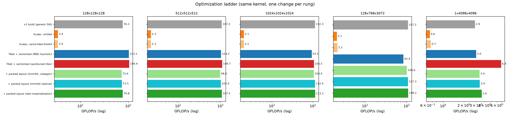
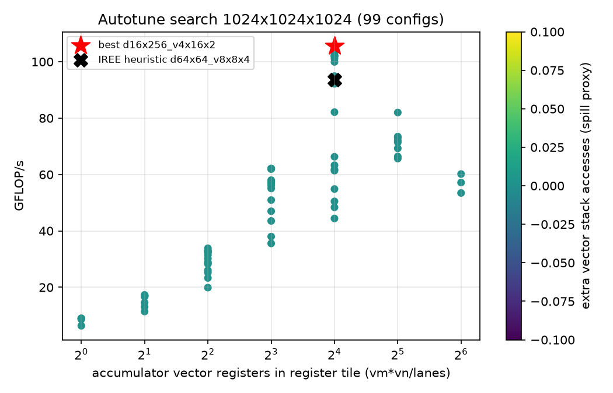
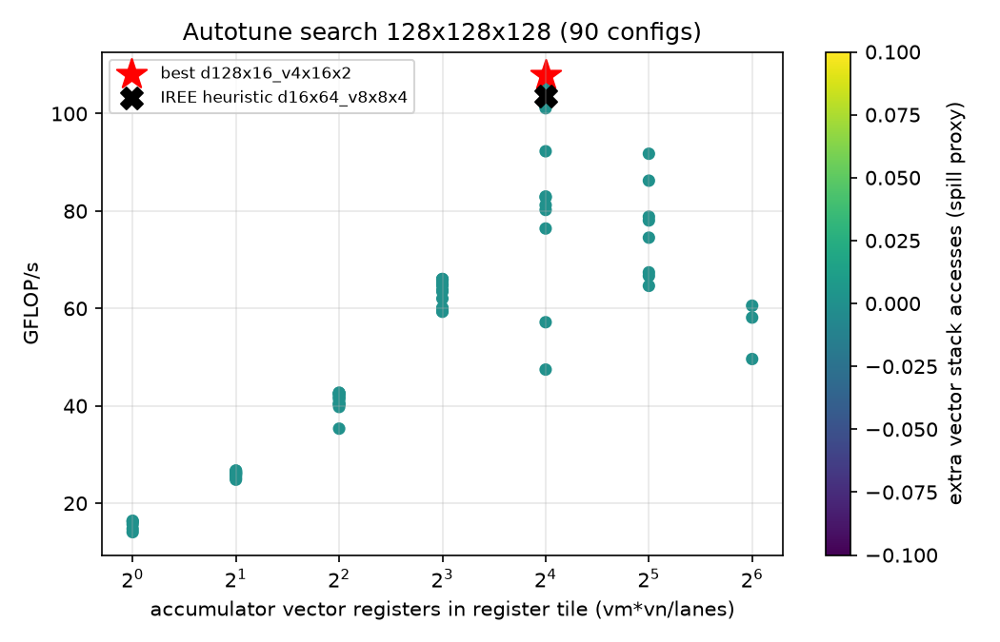
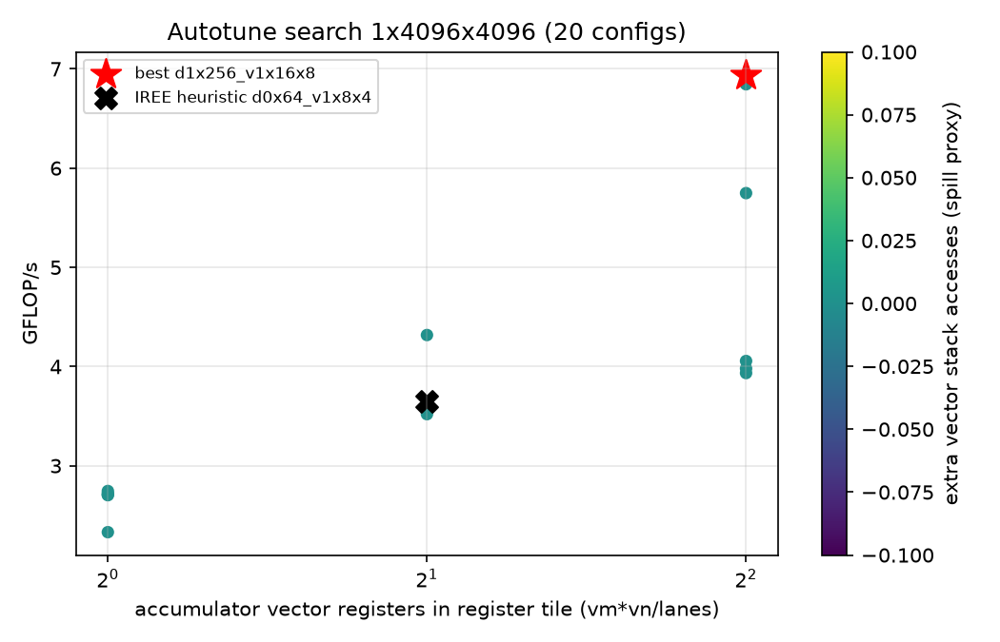
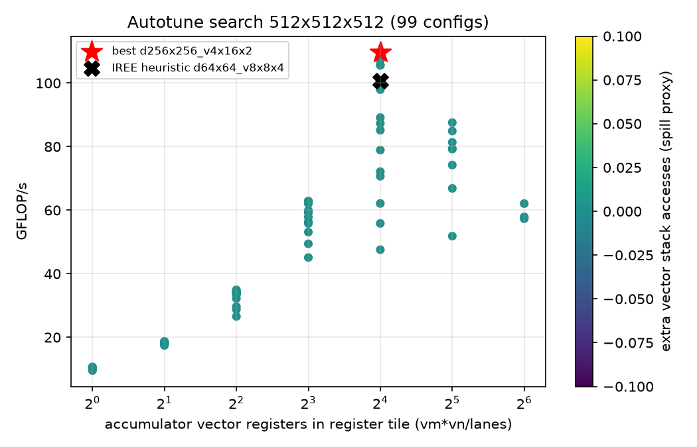
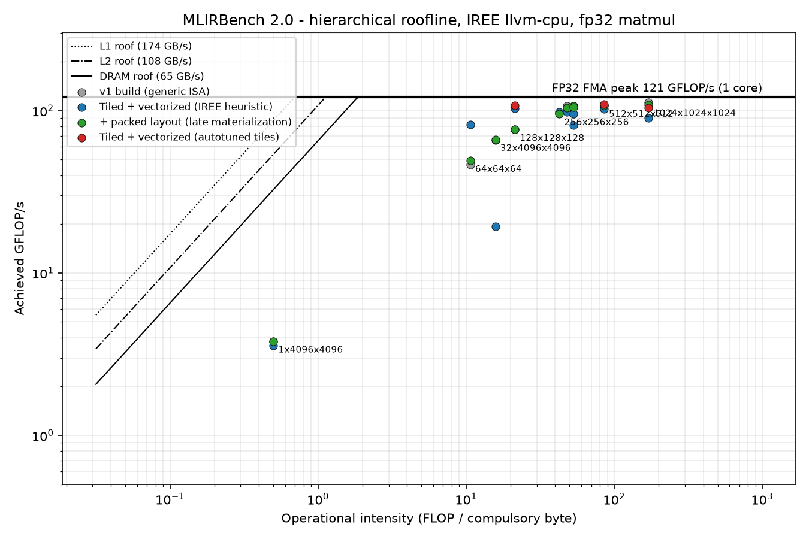

# MLIRBench 2.0 - generated results

Every number below is read from the JSON in `results/`; nothing is hand-entered. Timings are single-core (`--device=local-sync`), median across repetitions of `iree-benchmark-module`.

## Machine ceilings

Host: Apple M3 (bare metal), IREE compiler version 3.11.0rc20260316 @ e4a3b0405d7d23554da26403658d0e8c3c5ecf25

| Ceiling | Value | Ridge point (FLOP/B) |
|---|---|---|
| FP32 FMA peak | 120.8 GFLOP/s (128-bit, 16 acc) | - |
| L1 read bandwidth | 173.8 GB/s | 0.70 |
| L2 read bandwidth | 107.8 GB/s | 1.12 |
| DRAM read bandwidth | 65.2 GB/s | 1.85 |

Cache sizes: L1 128 KiB, L2 16384 KiB

## Optimization ladder

Invocation floor (1x1x1 matmul, fixed per-call cost): 0.0013 ms

### 128x128x128

| Variant | Tiles | median ms | p95 ms | GFLOP/s | % governing roof | packed FMA width (static count) | vs v1 build |
|---|---|---|---|---|---|---|---|
| v1 build (generic ISA) | heuristic | 0.0550 | 0.0554 | 76.3 | 63.1% | 128-bit (16) | 1.00x |
| Scalar, untiled | d0x0_v0x0x0 | 1.2374 | 1.2477 | 3.4 | 2.8% | scalar (0) | 0.04x |
| Scalar, cache-tiled 64x64 | d64x64_v0x0x0 | 1.2386 | 1.2472 | 3.4 | 2.8% | scalar (0) | 0.04x |
| Tiled + vectorized (IREE heuristic) | heuristic | 0.0407 | 0.0515 | 103.1 | 85.3% | 128-bit (64) | 1.35x |
| Tiled + vectorized (autotuned tiles) | d128x16_v4x16x2 | 0.0402 | 0.0464 | 104.4 | 86.4% | 128-bit (32) | 1.37x |
| + packed layout (mmt4d, codegen) | heuristic | 0.0577 | 0.0589 | 72.6 | 60.1% | 128-bit (16) | 0.95x |
| + packed layout (mmt4d ukernel) | heuristic | 0.0571 | 0.0625 | 73.5 | 60.8% | 128-bit (16) | 0.96x |
| + packed layout (late materialization) | heuristic | 0.0546 | 0.0547 | 76.8 | 63.6% | 128-bit (16) | 1.01x |

### 512x512x512

| Variant | Tiles | median ms | p95 ms | GFLOP/s | % governing roof | packed FMA width (static count) | vs v1 build |
|---|---|---|---|---|---|---|---|
| v1 build (generic ISA) | heuristic | 2.5042 | 2.5057 | 107.2 | 88.7% | 128-bit (16) | 1.00x |
| Scalar, untiled | d0x0_v0x0x0 | 118.0350 | 118.3567 | 2.3 | 1.9% | scalar (0) | 0.02x |
| Scalar, cache-tiled 64x64 | d64x64_v0x0x0 | 118.1128 | 118.1336 | 2.3 | 1.9% | scalar (0) | 0.02x |
| Tiled + vectorized (IREE heuristic) | heuristic | 2.6006 | 2.6048 | 103.2 | 85.4% | 128-bit (64) | 0.96x |
| Tiled + vectorized (autotuned tiles) | d256x256_v4x16x2 | 2.4472 | 2.4475 | 109.7 | 90.8% | 128-bit (32) | 1.02x |
| + packed layout (mmt4d, codegen) | heuristic | 2.7396 | 2.8370 | 98.0 | 81.1% | 128-bit (16) | 0.91x |
| + packed layout (mmt4d ukernel) | heuristic | 2.6328 | 3.1242 | 102.0 | 84.4% | 128-bit (16) | 0.95x |
| + packed layout (late materialization) | heuristic | 2.4960 | 2.4994 | 107.5 | 89.0% | 128-bit (16) | 1.00x |

### 1024x1024x1024

| Variant | Tiles | median ms | p95 ms | GFLOP/s | % governing roof | packed FMA width (static count) | vs v1 build |
|---|---|---|---|---|---|---|---|
| v1 build (generic ISA) | heuristic | 19.1260 | 19.1618 | 112.3 | 92.9% | 128-bit (16) | 1.00x |
| Scalar, untiled | d0x0_v0x0x0 | 1039.7530 | 1040.8226 | 2.1 | 1.7% | scalar (0) | 0.02x |
| Scalar, cache-tiled 64x64 | d64x64_v0x0x0 | 1041.5729 | 1043.0284 | 2.1 | 1.7% | scalar (0) | 0.02x |
| Tiled + vectorized (IREE heuristic) | heuristic | 22.9765 | 22.9780 | 93.5 | 77.4% | 128-bit (64) | 0.83x |
| Tiled + vectorized (autotuned tiles) | d16x256_v4x16x2 | 20.3535 | 20.3734 | 105.5 | 87.3% | 128-bit (32) | 0.94x |
| + packed layout (mmt4d, codegen) | heuristic | 20.3820 | 20.4195 | 105.4 | 87.2% | 128-bit (16) | 0.94x |
| + packed layout (mmt4d ukernel) | heuristic | 19.1066 | 19.1305 | 112.4 | 93.0% | 128-bit (16) | 1.00x |
| + packed layout (late materialization) | heuristic | 18.9792 | 19.0790 | 113.1 | 93.6% | 128-bit (16) | 1.01x |

### 128x768x3072

| Variant | Tiles | median ms | p95 ms | GFLOP/s | % governing roof | packed FMA width (static count) | vs v1 build |
|---|---|---|---|---|---|---|---|
| v1 build (generic ISA) | heuristic | 5.6357 | 5.6687 | 107.2 | 88.7% | 128-bit (16) | 1.00x |
| Scalar, untiled | d0x0_v0x0x0 | 286.1620 | 286.9099 | 2.1 | 1.7% | scalar (0) | 0.02x |
| Scalar, cache-tiled 64x64 | d64x64_v0x0x0 | 277.3265 | 277.7736 | 2.2 | 1.8% | scalar (0) | 0.02x |
| Tiled + vectorized (IREE heuristic) | heuristic | 7.2273 | 7.2340 | 83.6 | 69.2% | 128-bit (64) | 0.78x |
| + packed layout (mmt4d, codegen) | heuristic | 6.0046 | 6.0130 | 100.6 | 83.2% | 128-bit (16) | 0.94x |
| + packed layout (mmt4d ukernel) | heuristic | 5.6268 | 5.6498 | 107.3 | 88.8% | 128-bit (16) | 1.00x |
| + packed layout (late materialization) | heuristic | 5.5840 | 5.5941 | 108.2 | 89.5% | 128-bit (16) | 1.01x |

### 1x4096x4096

| Variant | Tiles | median ms | p95 ms | GFLOP/s | % governing roof | packed FMA width (static count) | vs v1 build |
|---|---|---|---|---|---|---|---|
| v1 build (generic ISA) | heuristic | 11.6270 | 13.2749 | 2.9 | 8.9% | 128-bit (2) | 1.00x |
| Scalar, untiled | d0x0_v0x0x0 | 52.1160 | 52.6247 | 0.6 | 2.0% | scalar (0) | 0.22x |
| Scalar, cache-tiled 64x64 | d1x64_v0x0x0 | 50.5211 | 50.8710 | 0.7 | 2.0% | scalar (0) | 0.23x |
| Tiled + vectorized (IREE heuristic) | heuristic | 11.1442 | 11.2612 | 3.0 | 9.2% | 128-bit (8) | 1.04x |
| + packed layout (mmt4d, codegen) | heuristic | 9.9437 | 12.2622 | 3.4 | 10.4% | 128-bit (2) | 1.17x |
| + packed layout (mmt4d ukernel) | heuristic | 9.8737 | 10.5818 | 3.4 | 10.4% | 128-bit (2) | 1.18x |
| + packed layout (late materialization) | heuristic | 9.2585 | 9.3802 | 3.6 | 11.1% | 128-bit (2) | 1.26x |
| Tiled + vectorized (autotuned tiles) | d1x256_v1x16x8 | 4.8553 | 5.0075 | 6.9 | 21.2% | 128-bit (32) | 2.39x |

## Hand-written transform-dialect schedule

`schedules/matmul.mlir.in` replaces IREE's codegen pipeline for the matmul. Each stage adds one transformation; `*` = minimum over 3 interleaved confirmation rounds. See `docs/TRANSFORM_SCHEDULE.md`.

| Stage (ms) | 128x128x128 (d128x16_v4x16x2) | 512x512x512 (d256x256_v4x16x1) | 1024x1024x1024 (d16x256_v4x16x2) |
|---|---|---|---|
| S1_tile_vectorize | 0.4044 | 30.3837 | 213.7175 |
| S2_outerproduct | 0.0569 | 7.8818 | 46.9522 |
| S3_hoist_acc | 0.0396* | 2.4765* | 19.7690* |
| S4_fuse_fill | 0.0379* | 2.4447* | 19.6045* |
| S5_kblock | 0.0396* | 2.5558* | 19.7254* |
| IREE_same_tiles | 0.0388* | 2.4400* | 20.3902* |
| IREE_packed_late | 0.0538* | 2.4910* | 18.9334* |

| Shape | best TK | full schedule vs IREE same tiles | K-blocked vs IREE same tiles | best mine vs best IREE |
|---|---|---|---|---|
| 128x128x128 | 64 | 102.4% | 98.1% | 102.4% |
| 512x512x512 | 256 | 99.8% | 95.5% | 99.8% |
| 1024x1024x1024 | 512 | 104.0% | 103.4% | 96.6% |

## Autotuner

| Shape | IREE heuristic | Autotuned | Configs | Rejected | heuristic ms | tuned ms | Speedup |
|---|---|---|---|---|---|---|---|
| 1024x1024x1024 | d64x64_v8x8x4 | d16x256_v4x16x2 | 99 | 4 | 22.9405 | 20.9426 | 1.10x |
| 128x128x128 | d16x64_v8x8x4 | d128x16_v4x16x2 | 90 | 4 | 0.0405 | 0.0388 | 1.04x |
| 1x4096x4096 | d0x64_v1x8x4 | d1x256_v1x16x8 | 20 | 0 | 9.4171 | 4.8674 | 1.93x |
| 512x512x512 | d64x64_v8x8x4 | d256x256_v4x16x2 | 99 | 4 | 2.6002 | 2.4461 | 1.06x |

Speedups are from a separate confirmation run (11 repetitions, 0.2 s each) of the winner and the heuristic, not from the search itself.

## Roofline sweep

| Shape | Kind | Variant | median ms | GFLOP/s | OI | Data lives in | Roof GF/s | % roof | floor share | Diagnosis |
|---|---|---|---|---|---|---|---|---|---|---|
| 64x64x64 | square | v1 build (generic ISA) | 0.0113 | 46.4 | 10.7 | L1 | 121 | 38.4% | 12% | 38% of the compute roof: codegen headroom (tiling / layout) |
| 64x64x64 | square | Tiled + vectorized (IREE heuristic) | 0.0064 | 82.1 | 10.7 | L1 | 121 | 67.9% | 21% | near the compute roof |
| 64x64x64 | square | + packed layout (late materialization) | 0.0107 | 49.2 | 10.7 | L1 | 121 | 40.7% | 12% | 41% of the compute roof: codegen headroom (tiling / layout) |
| 128x128x128 | square | v1 build (generic ISA) | 0.0548 | 76.5 | 21.3 | L2 | 121 | 63.3% | 2% | near the compute roof |
| 128x128x128 | square | Tiled + vectorized (IREE heuristic) | 0.0405 | 103.6 | 21.3 | L2 | 121 | 85.7% | 3% | near the compute roof |
| 128x128x128 | square | + packed layout (late materialization) | 0.0548 | 76.5 | 21.3 | L2 | 121 | 63.3% | 2% | near the compute roof |
| 128x128x128 | square | Tiled + vectorized (autotuned tiles) | 0.0389 | 107.9 | 21.3 | L2 | 121 | 89.3% | 3% | near the compute roof |
| 256x256x256 | square | v1 build (generic ISA) | 0.3491 | 96.1 | 42.7 | L2 | 121 | 79.6% | 0% | near the compute roof |
| 256x256x256 | square | Tiled + vectorized (IREE heuristic) | 0.3412 | 98.4 | 42.7 | L2 | 121 | 81.4% | 0% | near the compute roof |
| 256x256x256 | square | + packed layout (late materialization) | 0.3507 | 95.7 | 42.7 | L2 | 121 | 79.2% | 0% | near the compute roof |
| 512x512x512 | square | v1 build (generic ISA) | 2.5135 | 106.8 | 85.3 | L2 | 121 | 88.4% | 0% | near the compute roof |
| 512x512x512 | square | Tiled + vectorized (IREE heuristic) | 2.6151 | 102.6 | 85.3 | L2 | 121 | 85.0% | 0% | near the compute roof |
| 512x512x512 | square | + packed layout (late materialization) | 2.4956 | 107.6 | 85.3 | L2 | 121 | 89.0% | 0% | near the compute roof |
| 512x512x512 | square | Tiled + vectorized (autotuned tiles) | 2.4474 | 109.7 | 85.3 | L2 | 121 | 90.8% | 0% | near the compute roof |
| 1024x1024x1024 | square | v1 build (generic ISA) | 19.1938 | 111.9 | 170.7 | L2 | 121 | 92.6% | 0% | near the compute roof |
| 1024x1024x1024 | square | Tiled + vectorized (IREE heuristic) | 23.8348 | 90.1 | 170.7 | L2 | 121 | 74.6% | 0% | near the compute roof |
| 1024x1024x1024 | square | + packed layout (late materialization) | 19.7397 | 108.8 | 170.7 | L2 | 121 | 90.0% | 0% | near the compute roof |
| 1024x1024x1024 | square | Tiled + vectorized (autotuned tiles) | 20.6656 | 103.9 | 170.7 | L2 | 121 | 86.0% | 0% | near the compute roof |
| 128x768x768 | attn proj, 128 tok | v1 build (generic ISA) | 1.4179 | 106.5 | 48.0 | L2 | 121 | 88.1% | 0% | near the compute roof |
| 128x768x768 | attn proj, 128 tok | Tiled + vectorized (IREE heuristic) | 1.5436 | 97.8 | 48.0 | L2 | 121 | 81.0% | 0% | near the compute roof |
| 128x768x768 | attn proj, 128 tok | + packed layout (late materialization) | 1.4542 | 103.8 | 48.0 | L2 | 121 | 85.9% | 0% | near the compute roof |
| 128x768x3072 | FFN up, 128 tok | v1 build (generic ISA) | 5.6354 | 107.2 | 53.0 | L2 | 121 | 88.7% | 0% | near the compute roof |
| 128x768x3072 | FFN up, 128 tok | Tiled + vectorized (IREE heuristic) | 7.4189 | 81.4 | 53.0 | L2 | 121 | 67.4% | 0% | near the compute roof |
| 128x768x3072 | FFN up, 128 tok | + packed layout (late materialization) | 5.6473 | 107.0 | 53.0 | L2 | 121 | 88.5% | 0% | near the compute roof |
| 128x3072x768 | FFN down, 128 tok | v1 build (generic ISA) | 5.7276 | 105.5 | 53.0 | L2 | 121 | 87.3% | 0% | near the compute roof |
| 128x3072x768 | FFN down, 128 tok | Tiled + vectorized (IREE heuristic) | 6.2946 | 96.0 | 53.0 | L2 | 121 | 79.4% | 0% | near the compute roof |
| 128x3072x768 | FFN down, 128 tok | + packed layout (late materialization) | 5.7615 | 104.8 | 53.0 | L2 | 121 | 86.8% | 0% | near the compute roof |
| 32x4096x4096 | decode, batch 32 | v1 build (generic ISA) | 16.3759 | 65.6 | 15.8 | DRAM | 121 | 54.3% | 0% | 54% of the compute roof: codegen headroom (tiling / layout) |
| 32x4096x4096 | decode, batch 32 | Tiled + vectorized (IREE heuristic) | 55.4922 | 19.3 | 15.8 | DRAM | 121 | 16.0% | 0% | far below the compute roof: codegen-limited, not resource-limited |
| 32x4096x4096 | decode, batch 32 | + packed layout (late materialization) | 16.1919 | 66.3 | 15.8 | DRAM | 121 | 54.9% | 0% | 55% of the compute roof: codegen headroom (tiling / layout) |
| 1x4096x4096 | decode GEMV, batch 1 | v1 build (generic ISA) | 8.8239 | 3.8 | 0.5 | DRAM | 33 | 11.7% | 0% | far below the DRAM bandwidth roof: codegen-limited, not resource-limited |
| 1x4096x4096 | decode GEMV, batch 1 | Tiled + vectorized (IREE heuristic) | 9.4021 | 3.6 | 0.5 | DRAM | 33 | 10.9% | 0% | far below the DRAM bandwidth roof: codegen-limited, not resource-limited |
| 1x4096x4096 | decode GEMV, batch 1 | + packed layout (late materialization) | 8.8373 | 3.8 | 0.5 | DRAM | 33 | 11.6% | 0% | far below the DRAM bandwidth roof: codegen-limited, not resource-limited |

## Hardware counters

Backend used: **kperf**

- perf: unavailable - perf not found (Linux only; set MLIRBENCH_PERF)
- kperf: available
- xctrace: unavailable - xctrace not available: install full Xcode and run `sudo xcode-select -s /Applications/Xcode.app`

Per-invocation counts (iteration-differenced):

| Shape | Variant | backend | branch_mispred | cycles | instructions | l1d_miss_ld | l1d_miss_st | l1d_tlb_miss | ldst | simd_alu | simd_ld | simd_st |
|---|---|---|---|---|---|---|---|---|---|---|---|---|
| 128x128x128 | v1_generic_isa | kperf | 374 | 214,799 | 1,077,738 | n/a | n/a | n/a | 163,324 | 528,546 | 100,637 | 39,907 |
| 128x128x128 | scalar_naive | kperf | 16,653 | 4,734,010 | 17,019,886 | 11,581 | 21,951 | 293 | 6,342,093 | 2,097,279 | 4,210,884 | 2,097,983 |
| 128x128x128 | scalar_tiled | kperf | 16,662 | 4,686,608 | 17,034,497 | 12,175 | 8,436 | 297 | 6,342,276 | 2,097,279 | 4,210,886 | 2,097,985 |
| 128x128x128 | vec_heuristic | kperf | 55.273 | 159,900 | 976,717 | 5,207 | 4,001 | 206 | 323,369 | 528,511 | 303,315 | 2,894 |
| 128x128x128 | vec_autotuned | kperf | 17.317 | 153,433 | 884,905 | 11,133 | 5,582 | 264 | 217,699 | 528,511 | 196,812 | 3,911 |
| 128x128x128 | packed_mmt4d | kperf | 369 | 223,885 | 1,239,156 | 10,779 | 22,888 | 325 | 292,442 | 528,546 | 231,709 | 37,859 |
| 128x128x128 | packed_mmt4d_ukernel | kperf | 372 | 215,424 | 1,078,232 | 10,310 | 24,187 | 377 | 163,444 | 528,546 | 100,635 | 39,905 |
| 128x128x128 | packed_late | kperf | 321 | 214,150 | 1,075,090 | 9,604 | 22,902 | 263 | 160,757 | 528,542 | 100,621 | 37,835 |
| 1024x1024x1024 | v1_generic_isa | kperf | 27,433 | 74,495,706 | 403,802,244 | 3,936,832 | 1,399,138 | 195,904 | 38,372,947 | 268,697,763 | 35,782,942 | 2,491,364 |
| 1024x1024x1024 | scalar_naive | kperf | 1,053,715 | 3,964,471,038 | 8,609,568,959 | 1,068,354,062 | 101,421,390 | 622,472,958 | 3,223,340,563 | 1,073,741,951 | 2,148,532,419 | 1,073,742,654 |
| 1024x1024x1024 | scalar_tiled | kperf | 1,065,480 | 3,964,679,535 | 8,605,449,517 | 1,075,266,888 | 96,931,285 | 631,935,462 | 3,223,344,385 | 1,073,741,951 | 2,148,532,419 | 1,073,742,654 |
| 1024x1024x1024 | vec_heuristic | kperf | 18,720 | 84,065,257 | 492,945,981 | 29,189,592 | 331,904 | 13,548,436 | 130,184,096 | 268,697,727 | 130,023,875 | 132,158 |
| 1024x1024x1024 | vec_autotuned | kperf | 17,696 | 80,736,889 | 438,336,579 | 49,537,597 | 330,171 | 8,427,580 | 117,594,315 | 268,697,727 | 117,440,963 | 132,158 |
| 1024x1024x1024 | packed_mmt4d | kperf | 27,428 | 78,225,308 | 487,247,251 | 4,088,271 | 1,385,471 | 204,124 | 105,311,847 | 268,697,763 | 102,891,809 | 2,360,295 |
| 1024x1024x1024 | packed_mmt4d_ukernel | kperf | 27,431 | 72,942,647 | 403,584,619 | 4,001,392 | 1,386,486 | 203,870 | 38,375,057 | 268,697,763 | 35,782,944 | 2,491,366 |
| 1024x1024x1024 | packed_late | kperf | 25,131 | 72,514,902 | 403,350,727 | 3,798,118 | 1,260,898 | 199,592 | 38,199,055 | 268,697,759 | 35,782,928 | 2,360,270 |

Derived:

| Shape | Variant | flops_per_cycle | flops_upper_bound_from_simd | ipc | l1_line_bytes_assumed | l1_refill_bytes_est | l1_refill_bytes_vs_compulsory | simd_alu_per_analytic_fma_vec | simd_share_of_instructions |
|---|---|---|---|---|---|---|---|---|---|
| 128x128x128 | v1_generic_isa | 19.527 | 4,228,368.000 | 5.017 | n/a | n/a | n/a | 1.008 | 0.490 |
| 128x128x128 | scalar_naive | 0.886 | 16,778,232.099 | 3.595 | 128 | 4,292,079.391 | 21.831 | 4.000 | 0.123 |
| 128x128x128 | scalar_tiled | 0.895 | 16,778,232.000 | 3.635 | 128 | 2,638,113.244 | 13.418 | 4.000 | 0.123 |
| 128x128x128 | vec_heuristic | 26.231 | 4,228,088.000 | 6.108 | 128 | 1,178,676.352 | 5.995 | 1.008 | 0.541 |
| 128x128x128 | vec_autotuned | 27.336 | 4,228,088.000 | 5.767 | 128 | 2,139,592.384 | 10.883 | 1.008 | 0.597 |
| 128x128x128 | packed_mmt4d | 18.734 | 4,228,368.000 | 5.535 | 128 | 4,309,373.248 | 21.919 | 1.008 | 0.427 |
| 128x128x128 | packed_mmt4d_ukernel | 19.470 | 4,228,368.000 | 5.005 | 128 | 4,415,586.048 | 22.459 | 1.008 | 0.490 |
| 128x128x128 | packed_late | 19.586 | 4,228,336.000 | 5.020 | 128 | 4,160,788.736 | 21.163 | 1.008 | 0.492 |
| 1024x1024x1024 | v1_generic_isa | 28.827 | 2,149,582,104.000 | 5.420 | 128 | 683,004,160.000 | 54.280 | 1.001 | 0.665 |
| 1024x1024x1024 | scalar_naive | 0.542 | 8,589,935,608.000 | 2.172 | 128 | 149,731,257,770.667 | 11,899.571 | 4.000 | 0.125 |
| 1024x1024x1024 | scalar_tiled | 0.542 | 8,589,935,608.000 | 2.171 | 128 | 150,041,366,229.333 | 11,924.216 | 4.000 | 0.125 |
| 1024x1024x1024 | vec_heuristic | 25.545 | 2,149,581,816.000 | 5.864 | 128 | 3,778,751,493.818 | 300.308 | 1.001 | 0.545 |
| 1024x1024x1024 | vec_autotuned | 26.599 | 2,149,581,816.000 | 5.429 | 128 | 6,383,074,337.882 | 507.281 | 1.001 | 0.613 |
| 1024x1024x1024 | packed_mmt4d | 27.453 | 2,149,582,104.000 | 6.229 | 128 | 700,638,911.099 | 55.682 | 1.001 | 0.551 |
| 1024x1024x1024 | packed_mmt4d_ukernel | 29.441 | 2,149,582,104.000 | 5.533 | 128 | 689,648,377.263 | 54.808 | 1.001 | 0.666 |
| 1024x1024x1024 | packed_late | 29.614 | 2,149,582,072.000 | 5.562 | 128 | 647,554,086.737 | 51.463 | 1.001 | 0.666 |

Apple Silicon exposes no L2/SLC/DRAM miss events: `l1_refill_bytes_est` is L1D refill traffic (misses x cache line), i.e. L1<->L2 traffic, not DRAM traffic. `flops_upper_bound_from_simd` treats every SIMD ALU op as a 4-lane FMA.

## Thermal guard

Baseline probe 120.9 GFLOP/s, probe noise 0.1%, flag threshold 5.0%. 97 probes, 19 below threshold, 510 s spent cooling.

Results measured while throttled (re-run these): 128x128x128/v1_generic_isa, 128x128x128/scalar_naive, 128x128x128/scalar_tiled, 128x128x128/vec_heuristic, 128x128x128/vec_autotuned, 128x128x128/packed_mmt4d, 128x128x128/packed_mmt4d_ukernel, 128x128x128/packed_late, 512x512x512/v1_generic_isa, 512x512x512/scalar_naive, 512x512x512/scalar_tiled, 512x512x512/vec_heuristic, 512x512x512/vec_autotuned, 512x512x512/packed_mmt4d, 512x512x512/packed_mmt4d_ukernel, 512x512x512/packed_late, 1024x1024x1024/v1_generic_isa, 1024x1024x1024/scalar_naive, 1024x1024x1024/scalar_tiled, 1024x1024x1024/vec_heuristic, 1024x1024x1024/vec_autotuned, 1024x1024x1024/packed_mmt4d, 1024x1024x1024/packed_mmt4d_ukernel, 1024x1024x1024/packed_late, 128x768x3072/v1_generic_isa, 128x768x3072/scalar_naive, 128x768x3072/scalar_tiled, 128x768x3072/vec_heuristic, 128x768x3072/packed_mmt4d, 128x768x3072/packed_mmt4d_ukernel, 128x768x3072/packed_late, 1x4096x4096/v1_generic_isa, 1x4096x4096/scalar_naive, 1x4096x4096/scalar_tiled, 1x4096x4096/vec_heuristic, 1x4096x4096/packed_mmt4d, 1x4096x4096/packed_mmt4d_ukernel, 1x4096x4096/packed_late, 64x64x64/v1_generic_isa, 64x64x64/vec_heuristic, 64x64x64/packed_late, 128x128x128/v1_generic_isa, 128x128x128/vec_heuristic, 128x128x128/packed_late, 128x128x128/vec_autotuned, 256x256x256/v1_generic_isa, 256x256x256/vec_heuristic, 256x256x256/packed_late, 512x512x512/v1_generic_isa, 512x512x512/vec_heuristic, 512x512x512/packed_late, 512x512x512/vec_autotuned, 1024x1024x1024/v1_generic_isa, 1024x1024x1024/vec_heuristic, 1024x1024x1024/packed_late, 1024x1024x1024/vec_autotuned, 128x768x768/v1_generic_isa, 128x768x768/vec_heuristic, 128x768x768/packed_late, 128x768x3072/v1_generic_isa, 128x768x3072/vec_heuristic, 128x768x3072/packed_late, 128x3072x768/v1_generic_isa, 128x3072x768/vec_heuristic, 128x3072x768/packed_late, 32x4096x4096/v1_generic_isa, 32x4096x4096/vec_heuristic, 32x4096x4096/packed_late, 1x4096x4096/v1_generic_isa, 1x4096x4096/vec_heuristic, 1x4096x4096/packed_late

| time | chunk | phase | probe GF/s | % of baseline | waited s |
|---|---|---|---|---|---|
| 2026-09-26T02:18:42 | counters 128x128x128 | after | 121.2 | 93.4 | 0.0 |
| 2026-09-26T02:19:52 | counters 1024x1024x1024 | after | 120.9 | 93.2 | 0.0 |
| 2026-09-26T02:26:34 | ablate 128x128x128 | after | 120.7 | 93.1 | 0.0 |
| 2026-09-26T02:27:22 | ablate 512x512x512 | after | 121.2 | 93.4 | 0.0 |
| 2026-09-26T02:28:21 | ablate 1024x1024x1024 | after | 120.8 | 93.2 | 0.0 |
| 2026-09-26T02:29:08 | ablate 128x768x3072 | after | 120.8 | 93.2 | 0.0 |
| 2026-09-26T02:29:55 | ablate 1x4096x4096 | after | 120.8 | 93.1 | 0.0 |
| 2026-09-26T02:30:37 | sweep 64x64x64 | after | 122.0 | 94.1 | 0.0 |
| 2026-09-26T02:31:16 | sweep 128x128x128 | after | 121.6 | 93.8 | 0.0 |
| 2026-09-26T02:31:55 | sweep 256x256x256 | after | 120.8 | 93.1 | 0.0 |
| 2026-09-26T02:32:34 | sweep 512x512x512 | after | 121.1 | 93.4 | 0.0 |
| 2026-09-26T02:33:13 | sweep 1024x1024x1024 | after | 120.8 | 93.2 | 0.0 |
| 2026-09-26T02:33:52 | sweep 128x768x768 | after | 121.4 | 93.6 | 0.0 |
| 2026-09-26T02:34:29 | sweep 128x768x3072 | after | 120.8 | 93.2 | 0.0 |
| 2026-09-26T02:35:07 | sweep 128x3072x768 | after | 120.7 | 93.0 | 0.0 |
| 2026-09-26T02:35:46 | sweep 32x4096x4096 | after | 120.9 | 93.2 | 0.0 |
| 2026-09-26T02:36:23 | sweep 1x4096x4096 | after | 122.7 | 94.6 | 0.0 |
| 2026-09-26T02:38:20 | counters 128x128x128 | after | 121.0 | 93.3 | 0.0 |
| 2026-09-26T02:40:22 | counters 1024x1024x1024 | after | 120.8 | 93.2 | 0.0 |

## Binary level: ELF, symbol tables, objdump and DWARF

22 dispatch functions across aarch64, riscv64, x86_64. asm.py on the `.s` vs objdump on the ELF: FMA / vector / load / store / spill counts match in **22/22**. `.o` symbol size = DWARF `DW_TAG_subprogram` range in the linked `.so` in **22/22**.

| ISA | Variant | Shape | Dispatch symbol | .o sym bytes | DWARF bytes | vector FMA | stack accesses | asm.py = objdump | in .so symtab |
|---|---|---|---|---|---|---|---|---|---|
| aarch64 | v1_generic_isa | 128x128x128 | matmul_dispatch_0_pack_f32 | 116 | 116 | 0 | 0 | yes | no |
| aarch64 | v1_generic_isa | 128x128x128 | matmul_dispatch_1_pack_f32 | 128 | 128 | 0 | 0 | yes | no |
| aarch64 | v1_generic_isa | 128x128x128 | matmul_dispatch_2_mmt4d_16x16x128x8x8x1_f32 | 500 | 500 | 16 | 0 | yes | no |
| aarch64 | v1_generic_isa | 128x128x128 | matmul_dispatch_3_unpack_f32 | 180 | 180 | 0 | 0 | yes | no |
| aarch64 | vec_heuristic | 128x128x128 | matmul_dispatch_0_matmul_128x128x128_f32 | 772 | 772 | 64 | 0 | yes | no |
| aarch64 | packed_mmt4d_ukernel | 128x128x128 | matmul_dispatch_0_pack_f32 | 116 | 116 | 0 | 0 | yes | no |
| aarch64 | packed_mmt4d_ukernel | 128x128x128 | matmul_dispatch_1_pack_f32 | 128 | 128 | 0 | 0 | yes | no |
| aarch64 | packed_mmt4d_ukernel | 128x128x128 | matmul_dispatch_2_mmt4d_16x16x128x8x8x1_f32 | 500 | 500 | 16 | 0 | yes | no |
| aarch64 | packed_mmt4d_ukernel | 128x128x128 | matmul_dispatch_3_unpack_f32 | 180 | 180 | 0 | 0 | yes | no |
| x86_64 | cross_vec | 128x128x128 | matmul_dispatch_0_matmul_128x128x128_f32 | 1755 | 1755 | 128 | 0 | yes | no |
| riscv64 | cross_vec | 128x128x128 | matmul_dispatch_0_matmul_128x128x128_f32 | 588 | 588 | 9 | 0 | yes | no |
| aarch64 | v1_generic_isa | 512x512x512 | matmul_dispatch_0_pack_f32 | 148 | 148 | 0 | 0 | yes | no |
| aarch64 | v1_generic_isa | 512x512x512 | matmul_dispatch_1_pack_f32 | 128 | 128 | 0 | 0 | yes | no |
| aarch64 | v1_generic_isa | 512x512x512 | matmul_dispatch_2_mmt4d_64x64x512x8x8x1_f32 | 560 | 560 | 16 | 0 | yes | no |
| aarch64 | v1_generic_isa | 512x512x512 | matmul_dispatch_3_unpack_f32 | 176 | 176 | 0 | 0 | yes | no |
| aarch64 | vec_heuristic | 512x512x512 | matmul_dispatch_0_matmul_512x512x512_f32 | 880 | 880 | 64 | 0 | yes | no |
| aarch64 | packed_mmt4d_ukernel | 512x512x512 | matmul_dispatch_0_pack_f32 | 148 | 148 | 0 | 0 | yes | no |
| aarch64 | packed_mmt4d_ukernel | 512x512x512 | matmul_dispatch_1_pack_f32 | 128 | 128 | 0 | 0 | yes | no |
| aarch64 | packed_mmt4d_ukernel | 512x512x512 | matmul_dispatch_2_mmt4d_64x64x512x8x8x1_f32 | 564 | 564 | 16 | 0 | yes | no |
| aarch64 | packed_mmt4d_ukernel | 512x512x512 | matmul_dispatch_3_unpack_f32 | 176 | 176 | 0 | 0 | yes | no |
| x86_64 | cross_vec | 512x512x512 | matmul_dispatch_0_matmul_512x512x512_f32 | 2012 | 2012 | 128 | 0 | yes | no |
| riscv64 | cross_vec | 512x512x512 | matmul_dispatch_0_matmul_512x512x512_f32 | 654 | 654 | 8 | 0 | yes | no |

Linked `.so` symbol tables keep only: `{'.dynsym': ['iree_hal_executable_library_query'], '.symtab': ['_DYNAMIC', 'iree_hal_executable_library_query']}`. The `.o` has 36 FUNC symbols (5032 bytes of `.text*`); after linking, `.text` is 944 bytes: unused runtime helpers are dropped.

### Hottest loop, mapped back to MLIR through `.debug_line`

| ISA | Variant | Shape | Dispatch | Address range | Insns | Vector FMA | Insns with an op-level line | Lines (insns) |
|---|---|---|---|---|---|---|---|---|
| aarch64 | v1_generic_isa | 128x128x128 | matmul_dispatch_0_pack_f32 | 0x10954-0x1096c | 6 | 0 | 100.0% | L14 linalg.pack (6) |
| aarch64 | v1_generic_isa | 128x128x128 | matmul_dispatch_1_pack_f32 | 0x109dc-0x109f4 | 6 | 0 | 100.0% | L15 linalg.pack (6) |
| aarch64 | v1_generic_isa | 128x128x128 | matmul_dispatch_2_mmt4d_16x16x128x8x8x1_f32 | 0x10b24-0x10b80 | 23 | 16 | 100.0% | L20 linalg.mmt4d (23) |
| aarch64 | v1_generic_isa | 128x128x128 | matmul_dispatch_3_unpack_f32 | 0x10c60-0x10c74 | 5 | 0 | 100.0% | L15 linalg.unpack (5) |
| aarch64 | vec_heuristic | 128x128x128 | matmul_dispatch_0_matmul_128x128x128_f32 | 0x10590-0x1074c | 111 | 64 | 13.5% | L1 (function-level location only) (96); L18 linalg.matmul (15) |
| aarch64 | packed_mmt4d_ukernel | 128x128x128 | matmul_dispatch_0_pack_f32 | 0x1096c-0x10984 | 6 | 0 | 100.0% | L14 linalg.pack (6) |
| aarch64 | packed_mmt4d_ukernel | 128x128x128 | matmul_dispatch_1_pack_f32 | 0x109f4-0x10a0c | 6 | 0 | 100.0% | L15 linalg.pack (6) |
| aarch64 | packed_mmt4d_ukernel | 128x128x128 | matmul_dispatch_2_mmt4d_16x16x128x8x8x1_f32 | 0x10b3c-0x10b98 | 23 | 16 | 100.0% | L20 linalg.mmt4d (23) |
| aarch64 | packed_mmt4d_ukernel | 128x128x128 | matmul_dispatch_3_unpack_f32 | 0x10c78-0x10c8c | 5 | 0 | 100.0% | L15 linalg.unpack (5) |
| x86_64 | cross_vec | 128x128x128 | matmul_dispatch_0_matmul_128x128x128_f32 | 0x1590-0x1b35 | 148 | 128 | 13.5% | L1 (function-level location only) (128); L18 linalg.matmul (20) |
| riscv64 | cross_vec | 128x128x128 | matmul_dispatch_0_matmul_128x128x128_f32 | 0x1612-0x1658 | 18 | 7 | 22.2% | L1 (function-level location only) (14); L18 linalg.matmul (4) |
| aarch64 | v1_generic_isa | 512x512x512 | matmul_dispatch_0_pack_f32 | 0x10960-0x10978 | 6 | 0 | 100.0% | L14 linalg.pack (6) |
| aarch64 | v1_generic_isa | 512x512x512 | matmul_dispatch_1_pack_f32 | 0x109f0-0x10a0c | 7 | 0 | 100.0% | L15 linalg.pack (7) |
| aarch64 | v1_generic_isa | 512x512x512 | matmul_dispatch_2_mmt4d_64x64x512x8x8x1_f32 | 0x10b7c-0x10bd8 | 23 | 16 | 100.0% | L20 linalg.mmt4d (23) |
| aarch64 | v1_generic_isa | 512x512x512 | matmul_dispatch_3_unpack_f32 | 0x10cb0-0x10cc4 | 5 | 0 | 100.0% | L15 linalg.unpack (5) |
| aarch64 | vec_heuristic | 512x512x512 | matmul_dispatch_0_matmul_512x512x512_f32 | 0x105f4-0x107b4 | 112 | 64 | 14.3% | L1 (function-level location only) (96); L18 linalg.matmul (16) |
| aarch64 | packed_mmt4d_ukernel | 512x512x512 | matmul_dispatch_0_pack_f32 | 0x10978-0x10990 | 6 | 0 | 100.0% | L14 linalg.pack (6) |
| aarch64 | packed_mmt4d_ukernel | 512x512x512 | matmul_dispatch_1_pack_f32 | 0x10a08-0x10a24 | 7 | 0 | 100.0% | L15 linalg.pack (7) |
| aarch64 | packed_mmt4d_ukernel | 512x512x512 | matmul_dispatch_2_mmt4d_64x64x512x8x8x1_f32 | 0x10b98-0x10bf4 | 23 | 16 | 100.0% | L20 linalg.mmt4d (23) |
| aarch64 | packed_mmt4d_ukernel | 512x512x512 | matmul_dispatch_3_unpack_f32 | 0x10ccc-0x10ce0 | 5 | 0 | 100.0% | L15 linalg.unpack (5) |
| x86_64 | cross_vec | 512x512x512 | matmul_dispatch_0_matmul_512x512x512_f32 | 0x1640-0x1c38 | 148 | 128 | 13.5% | L1 (function-level location only) (128); L18 linalg.matmul (20) |
| riscv64 | cross_vec | 512x512x512 | matmul_dispatch_0_matmul_512x512x512_f32 | 0x1658-0x16b0 | 23 | 7 | 39.1% | L1 (function-level location only) (14); L18 linalg.matmul (9) |
